<p align="center">
  <picture>
    <source media="(prefers-color-scheme: dark)" srcset="docs/images/hero-dark.svg">
    
  </picture>
</p>

<p align="center">
  <a href="https://github.com/akano12/Doppel/releases"></a>
  
  
  <a href="#license"></a>
  <a href="https://xdaforums.com/t/module-6-0-lsposed-doppel-fake-data-for-apps-maintained-continuation-of-xprivacylua.4806280/"></a>
</p>

<p align="center">
  <a href="#features">Features</a> ·
  <a href="#screenshots">Screenshots</a> ·
  <a href="#installation">Install</a> ·
  <a href="#restrictions">Restrictions</a> ·
  <a href="FAQ.md">FAQ</a> ·
  <a href="#building">Building</a>
</p>

**Revoking a permission often makes an app crash. Doppel lets the app keep it and feeds it fake data instead**,
so the app keeps working and learns nothing true about you.

A doppelgänger is a person's ghostly twin: it looks like you, answers like you, and isn't you.
When an app asks for your location, contacts or device ID, your double answers in your place.

> [!NOTE]
> Doppel continues [XPrivacyLua](https://github.com/M66B/XPrivacyLua) by Marcel Bokhorst (M66B), which is not maintained anymore,
> with a new interface, updates for current Android versions and new restrictions, under the same license, the [GPL version 3](#license).

How it works
------------

<picture>
  <source media="(prefers-color-scheme: dark)" srcset="docs/images/how-it-works-dark.svg">
  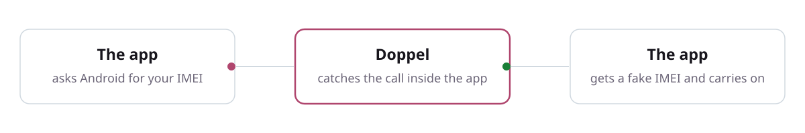
</picture>

Your real data never reaches the app. Each hook that restricted an app shows up under *Activity*, with the time of its last restriction and the real and the fake value.

What an app sees
----------------

<picture>
  <source media="(prefers-color-scheme: dark)" srcset="docs/images/demo-dark.gif">
  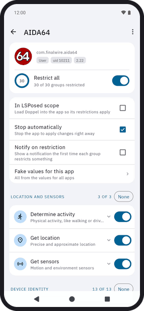
</picture>


| The app asks for             | Without Doppel     | With Doppel              |
|------------------------------|--------------------|--------------------------|
| IMEI, Android ID             | the real ones      | fakes, new each boot     |
| Serial number                | the real one       | unknown                  |
| Location                     | where you are      | a place you choose       |
| Contacts, calendar, call log | all of them        | hidden                   |
| Other apps                   | all of them        | hidden                   |
| Battery                      | 84%, charging      | 80%, no charging details |
| Clipboard                    | what you copied    | a fake paste             |
| `getprop`, `pm`, `cat`       | the real values    | refused                  |

In the demo, AIDA64 joins Doppel's LSPosed scope from its own screen: approve the request, and *Restrict all* applies every group. Each call it makes then gets the fake values.

<br clear="left">

Features
--------

<picture>
  <source media="(prefers-color-scheme: dark)" srcset="docs/images/features-dark.svg">
  
</picture>

Screenshots
-----------

<table>
  <tr><td align="center">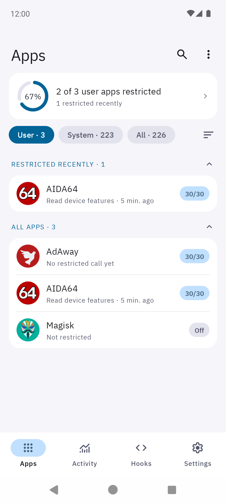<br><sub>App list</sub></td><td align="center">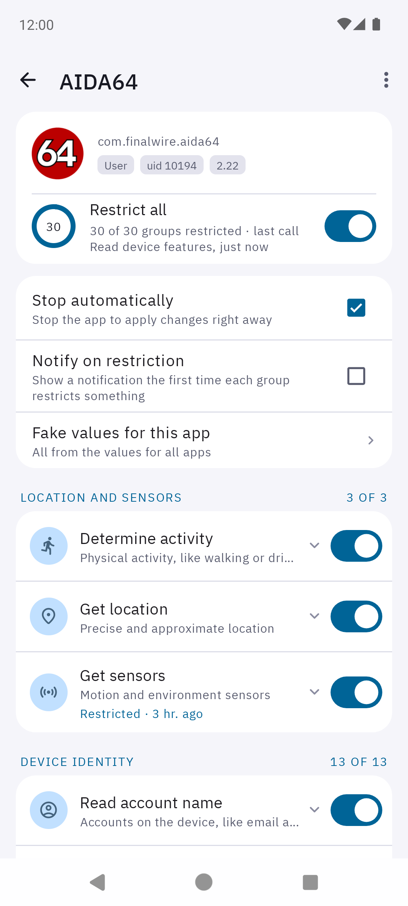<br><sub>Per-app restrictions</sub></td><td align="center">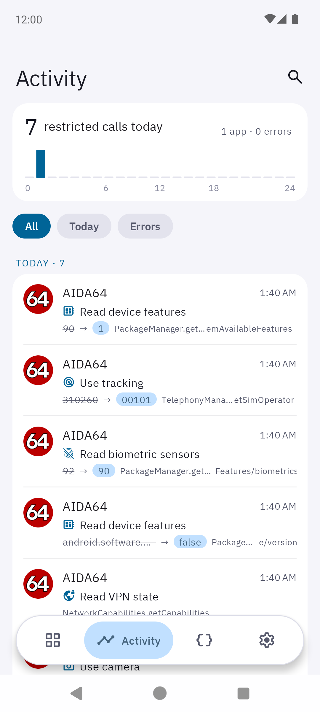<br><sub>Fake values</sub></td><td align="center">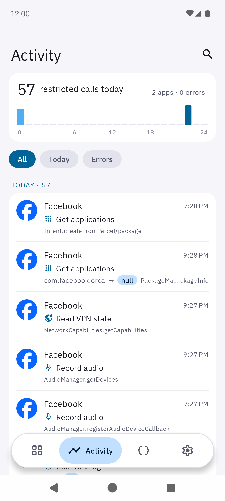<br><sub>Restriction activity</sub></td><td align="center">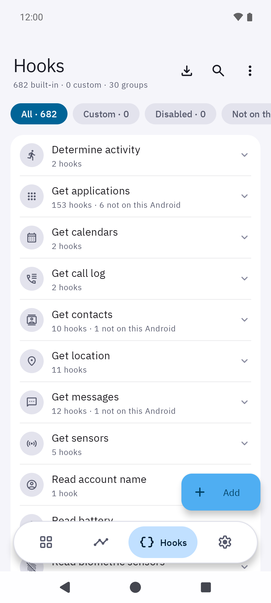<br><sub>Hooks</sub></td></tr>
  <tr><td align="center">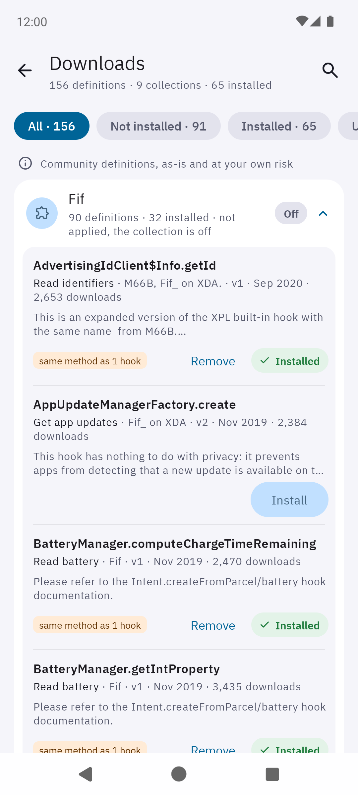<br><sub>Downloads</sub></td><td align="center">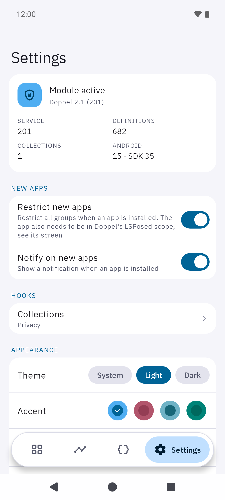<br><sub>Settings</sub></td><td align="center">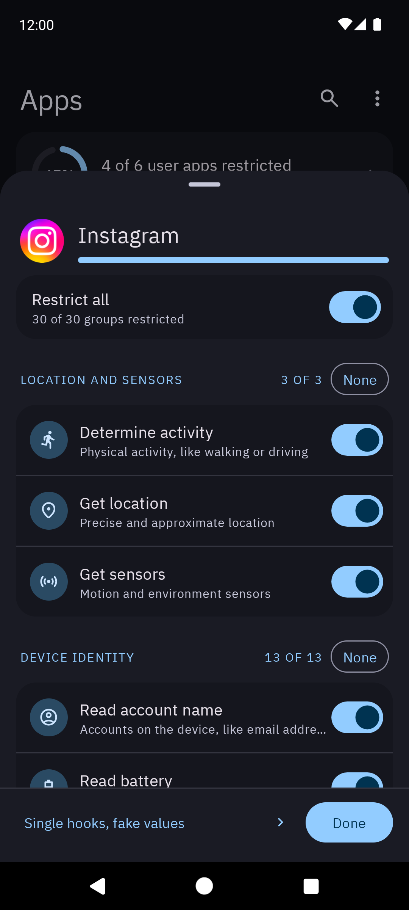<br><sub>Quick restrict</sub></td><td align="center">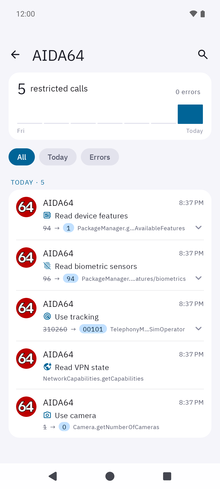<br><sub>App log</sub></td><td align="center">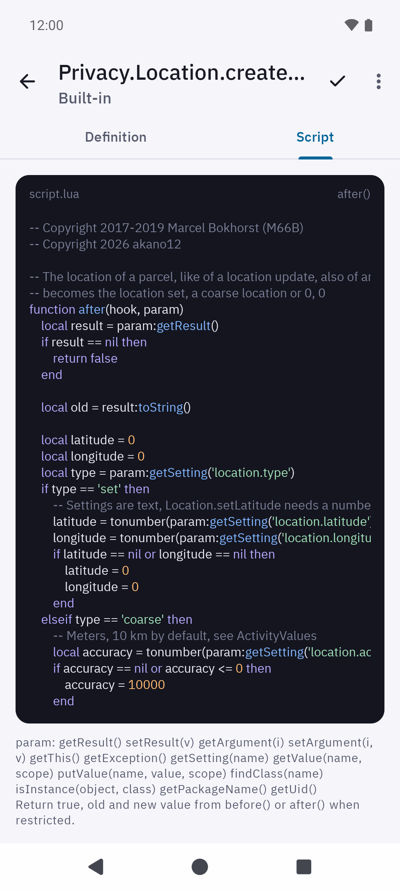<br><sub>Hook editor</sub></td></tr>
</table>

Installation
------------

Doppel needs Android 8.1 or later and a rooted device with an Xposed framework.
It uses the [modern Xposed API](https://github.com/libxposed/api) (version 101 or later) when the framework has it, else the legacy API.

1. Root the device, like with [Magisk](https://topjohnwu.github.io/Magisk/install.html)
2. Install and activate an Xposed framework: [LSPosed](https://github.com/LSPosed/LSPosed) or a compatible fork
3. Install Doppel from the [releases](https://github.com/akano12/Doppel/releases) and enable it in the framework
4. Reboot

> [!IMPORTANT]
> In LSPosed, the scope needs *System Framework*, which hosts the Doppel service, and each app you want to restrict;
> with the legacy API (like EdXposed) also *Settings Storage*.
> Add only apps you restrict: LSPosed is loaded into every app in the scope.
> With the modern API, *In LSPosed scope* on the screen of an app adds it for you.

### Work profiles and other users

Doppel supports work profiles and other users: each has its own restricted apps, fake values and settings, and apps
cannot read those of another one. For a profile or user:

1. Install Doppel in it too, like from an app store in the profile, or with
   `adb shell pm install-existing --user <id> sk.akano12.doppel`
2. In LSPosed, enable Doppel for that user and add its apps to the scope; *System Framework* of the owner is enough
3. Open Doppel in the profile or user (the one with the briefcase for a work profile) to restrict its apps

With *Use tracking*, restricted apps are not told about the other users and profiles of the device.

> [!WARNING]
> Uninstall XPrivacyLua first: both use the same service and data.
> A build signed with another key than the official release cannot update it; uninstall the official release first.

Restrictions
------------

A restriction hides data (an empty list) or fakes it (an empty or fake value).
An app restricted by *Run commands*, or by a group whose values commands could read, cannot run system programs or
shells, like getprop, pm, cat or sh: each command fails like a program the app may not run (`IOException`, error=13,
Permission denied), so the values cannot be read past the fakes. Programs which come in the app's own native library folder still run: they are native code of the app,
which Doppel does not cover anyway.
The details are in [hooks.json](app/src/main/assets/hooks.json).

<details>
<summary><b>Who you are</b> · 5 groups</summary>

* **Read account name**: fake name, also in contacts and calendars
* **Read biometric sensors**: no fingerprint sensor, face or iris unlock, also in the prompt of biometrics
* **Read identifiers**: fake serial, Android ID, DRM id, advertising and app set ID, MAC addresses, ids of file systems
  made of their UUID;
  the permanent ids of the chip, SD card and storage in /sys do not exist, and neither do the advertising ids (OAID)
  of the services of device makers (Samsung, Lenovo, Asus, OPPO, OnePlus, realme, Honor, Huawei, Coolpad, Nubia,
  Freeme and 360, also any service with one of their interfaces), the ids they and SDKs keep in the settings
  (Huawei, Honor, Xiaomi, OnePlus, Amazon Fire OS, Baidu) and the SIM serial in their system properties
* **Read telephony data**: fake IMEI, MEID, SIM serial, phone number and more, also in the phone accounts of the SIMs
  and in the calls of the call log
* **Use tracking**: fake device model and build, operator, device name, WebView user agent, install times of other apps,
  boot id and the folder times and inodes that tell when the device was set up; the hardware files in /sys, the
  property files of the partitions, the GPU drivers and the vendor's HAL manifests, SELinux contexts and display
  configuration do not exist, nor do
  the files of the processors (8 processors, also in /proc/cpuinfo), and the fonts of device makers are not listed,
  also in the font configuration; codec names, the GPU and OpenGL extensions without the vendor of the chip, the camera
  without the version of its hardware; the app's memory maps without the vendor's libraries and the mount tables and
  file stores without the storage controller; other users and work profiles, user-installed certificates, the heat, the
  vibrator, the audio buffer and the screen lock like on a plain device

</details>

<details>
<summary><b>Where you are</b> · 5 groups</summary>

* **Determine activity**: fake unknown activity, no activity transitions or sleep events
* **Get location**: fake location, no NMEA messages or raw GNSS measurements, no location of Wi-Fi access points (RTT), and no location of photos and videos.
  Do not restrict it for camera, gallery and photo editing apps whose photos should keep their location: what such
  an app saves, like an edited copy, is saved without it
* **Get sensors**: hide them, also as features of the device, and dynamic sensors, like the head tracker of headphones; the proximity sensor cannot turn the screen off
* **Read languages**: fake languages, *Languages* in *Fake values*, default en-US, also in system properties
  and the settings; no region of sale (Samsung, Xiaomi); only keyboard languages of the fake ones. The app keeps
  the language chosen for it and its texts; the language of its configuration stays real
* **Read time zone**: fake time zone, *Time zone* in *Fake values*, default UTC

</details>

<details>
<summary><b>Your data</b> · 8 groups</summary>

* **Get calendars**: hide them
* **Get call log**: hide it, also the number of incoming and outgoing calls
* **Get contacts**: hide contacts, optionally except (non) starred ones, and blocked numbers
* **Get messages**: hide SMS, MMS, SIM messages and voicemail
* **Read clipboard**: fake paste
* **Learn typing**: ask the keyboard not to learn what is typed, like in incognito mode; keyboards can ignore it
* **Read notifications**: hide the notifications and media sessions of other apps
* **Read sync data**: hide sync data

</details>

<details>
<summary><b>Your device and apps</b> · 8 groups</summary>

* **Get applications**: hide other apps, their components, widgets, install sessions and usage statistics, keyboards
  and accessibility services, also in the permission files of system apps and the folders of system apps; hidden apps
  cannot be reached, their providers cannot be observed, and they are not named as the maker of a PendingIntent, as
  the default browser or as the users of a shared library
* **Read battery**: level in steps of 10 percent, at least 15, no charge details, battery saver off
* **Read debugging state**: developer options (also Stay awake and the log buffer sizes) and USB or wireless debugging off, a build which is not debuggable; the files of su and Magisk do not exist
* **Read device features**: only the features in *Shown device features* (*Fake values*), no external keyboards and game controllers; the feature and permission files of the system do not exist. The features of the camera, microphone, sensors and biometric sensors are left to *Use camera*, *Record audio*, *Get sensors* and *Read biometric sensors*
* **Read device settings**: the values of a new device, like the animation scale and the screen timeout
* **Read memory and storage**: sizes rounded like devices are sold, free space rounded down, and the memory apps may
  use rounded down to a common step
* **Read network data**: hide cells, Wi-Fi networks, Bluetooth devices (also in broadcasts) and local network discovery,
  fake Wi-Fi name
* **Read VPN state**: no VPN, also without its routes and search domains and the settings of always-on VPN

</details>

<details>
<summary><b>Recording</b> · 3 groups</summary>

* **Record audio**, **Record video**: prevent recording, also speech recognition; a started AudioRecord gives silence,
  like a microphone another app took; of the audio devices only the speaker and the earpiece are left, also for calls;
  *Record audio* also hides the microphone feature and connected headsets
* **Use camera**: no camera, also not as a feature of the device, and no torch

</details>

<details>
<summary><b>Actions and analytics</b> · 3 groups</summary>

* **Run commands**: commands fail, like `su`, `id` or `getprop`, except programs in the app's own native library
  folder. *Read biometric sensors*, *Get sensors*, *Read identifiers*, *Use tracking*, *Read languages*, *Read time zone*,
  *Get applications*, *Read debugging state*, *Read device features*, *Read memory and storage*, *Read network
  data* and *Read VPN state* refuse commands the same way, since commands could read their values
* **Send messages**: prevent sending SMS, MMS and data messages
* **Use analytics**: Adjust, AppsFlyer, Facebook app events, Firebase Analytics (without consent, so no app
  instance id), Crashlytics and Performance Monitoring, Google Analytics v4, Mixpanel, Segment, Amplitude, Branch,
  Microsoft Clarity, Sentry, Singular, Umeng; Unity Ads without consent for personalized ads, Amazon Publisher
  Services without consent and location

</details>

### Limits

<details>
<summary>What Doppel cannot do</summary>

* Xposed cannot hook native code: audio recorded with OpenSL ES, like WhatsApp does, and files read natively
  are not restricted. Native code also sees the real system properties, codecs, GPU, processors, fonts and sensors,
  and can start processes itself, which are not refused. Apps reading the bytes of photos themselves still find their
  location.
* Services an app runs in isolated processes, and its app zygote preload (Android 10 and later), get no hooks, since
  the framework does not load modules there: they see the real `Build` values, like the model and fingerprint, and can
  pass them to the app. The app's own `AppComponentFactory` (Android 9 and later) runs before the hooks are installed
  and reads the real `Build` values too.
* Pages in a WebView run in Chromium's native code too: their WebGL names the real GPU, its vendor and extensions, and
  navigator.hardwareConcurrency gives the real number of processors, which can differ from what *Use tracking* fakes.
* *Use analytics* and some other hooks hook libraries inside apps, which only works when the app did not
  [obfuscate](https://developer.android.com/studio/build/shrink-code.html) their names.
  The Firebase, Segment, Amazon and Facebook SDKs store the opt-outs and consents *Use analytics* sets, so collection
  stays off after the restriction is removed, until the app turns it on again or its data is cleared.
* *Get applications* keeps the app itself, apps sharing its user id and system apps visible to lookups of single apps,
  because the Android code running in apps, like WebView, needs them.
* Discovery of local devices with the app's own sockets, like mDNS or SSDP, cannot be prevented.
* The paths of other apps, like `/data/app/~~…==/com.example-…==/base.apk`, stay: Android reads their icons and labels
  from these files inside the app. They differ per install, so restrict *Get applications* to hide other apps entirely.
* The boot time is not faked: apps can work it out (the wall clock minus the time since boot) and use it to link
  each other until the device restarts. Hooks on these clocks do not reach compiled app code on Android 12 and newer.
* Apps which call a service of Android with `IBinder.transact` and a parcel they build themselves get past the hooks,
  which see the methods of Android only, like the lookups of *Get applications*.
* Restricted apps can detect Doppel, but cannot change anything, see [the FAQ](FAQ.md#user-content-faq21).
* Apps with root access can get around any restriction.

</details>

Help
----

* Questions: see the [FAQ](FAQ.md), or ask in the [XDA thread](https://xdaforums.com/t/module-6-0-lsposed-doppel-fake-data-for-apps-maintained-continuation-of-xprivacylua.4806280/)
* Problems with Doppel: open an [issue](https://github.com/akano12/Doppel/issues)
* Problems with LSPosed or another framework: ask where that framework is supported

Doppel with Island and similar apps is not supported.

Contributing
------------

Pull requests are welcome for the documentation.
For code, please open an [issue](https://github.com/akano12/Doppel/issues) first.
Definitions to share go into Downloads, see [here](docs/DEFINE.md#sharing).
By contributing you agree to the license below.

Building
--------

<details>
<summary>Build from source</summary>

With [Android Studio](https://developer.android.com/studio), or from the command line with JDK 17 or later and the Android SDK (platform 37):

```
./gradlew assembleDebug        # debug build
./gradlew assembleRelease      # release build, signed when keystore.properties exists
./gradlew testDebugUnitTest    # the hook definitions, the scripts, the service and the backup, on the JVM
./gradlew assembleDebugAndroidTest  # the tests on a device: database upgrades, service writes and fake files;
                               # assignments and a restore need Doppel active, else they are skipped
adb install -r -t app/build/outputs/apk/androidTest/debug/*.apk    # with the debug build installed, then:
adb shell am instrument -w sk.akano12.doppel.test/androidx.test.runner.AndroidJUnitRunner
scripts/check-service.sh       # on a rooted device or emulator with Doppel: whom the service answers
```

How the code fits together (package `eu.faircode.xlua`, kept from XPrivacyLua):

* Entry points: `XLuaModule` for the modern API (*META-INF/xposed/java_init.list*), `XLua` for the legacy API
  (*assets/xposed_init*); both hand over to `XCore`, through `ModernBackend` or `LegacyBackend`.
* The service runs in system server: `XCore.hookSettings` hooks `call` and `query` of the settings provider, which
  `XProvider` answers, with its database (`XDatabase`) in */data/system/xlua*. `XProvider.answers` decides who gets
  answers: system server, Doppel itself and restricted apps for their own data; other apps get the answers of a
  device without Doppel. `scripts/check-service.sh` checks this on a device.
* In each app in the scope, `XCore` asks the service (`Data`) for the hooks assigned to the app and installs them
  before the app's own code runs. A hook is a definition of [hooks.json](app/src/main/assets/hooks.json) with a Lua
  script of *app/src/main/assets*, run by the LuaJ copy in *org.luaj* with `XHook` and `XParam`, see
  [DEFINE.md](docs/DEFINE.md). The definitions of Downloads (*repo*) are packaged as *assets/repo*.
* The screens (`Activity*`, `Fragment*`) use the service through `Data` too.
* The unit tests run the scripts with Lua stand-ins for Android objects (`Scripts`) and check every definition
  against the SDK (`HookDefinitionsTest`); a new or changed hook needs a test there.

Not `./gradlew connectedDebugAndroidTest`: it uninstalls Doppel afterwards, which removes its restrictions, settings and LSPosed scope.

*keystore.properties* (storeFile, storePassword, keyAlias, keyPassword) goes next to this file.
Sign with the v1 and v2 schemes only, like the build does: LSPosed cannot read an APK with a v3 signature.

</details>

Attribution
-----------

<details>
<summary>Doppel uses</summary>

* [LuaJ](https://sourceforge.net/projects/luaj/). Copyright 2007-2013 LuaJ. All rights reserved. See [license](https://luaj.sourceforge.net/license.txt).
* [Glide](https://bumptech.github.io/glide/). Copyright 2014 Google, Inc. All rights reserved. See [license](https://raw.githubusercontent.com/bumptech/glide/master/LICENSE).
* [AndroidX](https://developer.android.com/jetpack/androidx). Copyright (C) 2011 The Android Open Source Project. See [license](https://android.googlesource.com/platform/frameworks/support/+/androidx-main/LICENSE.txt).
* [Material Components for Android](https://github.com/material-components/material-components-android). Copyright Google LLC. See [license](https://www.apache.org/licenses/LICENSE-2.0) (Apache License 2.0).
* [libxposed service](https://github.com/libxposed/service). See [license](https://github.com/libxposed/service/blob/master/LICENSE) (Apache License 2.0).
* [IBM Plex](https://github.com/IBM/plex) fonts, also in the images of this page. Copyright © 2017 IBM Corp. with Reserved Font Name "Plex". See [license](LICENSE-FONTS.txt) (SIL Open Font License 1.1).
* [Material Symbols](https://github.com/google/material-design-icons) icons, also in the images of this page. Copyright Google LLC. See [license](https://www.apache.org/licenses/LICENSE-2.0) (Apache License 2.0).

</details>

License
-------

Copyright (c) 2017-2022 Marcel Bokhorst. All rights reserved.<br>
Copyright (c) 2026 akano12. All rights reserved.

Doppel is free software under the [GNU General Public License version 3](LICENSE) or (at your option) any later version,
without any warranty.

*Android and Google Play are trademarks of Google LLC.*
