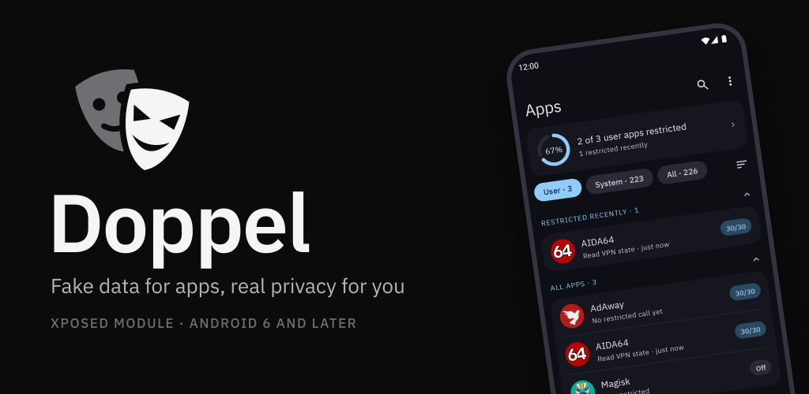
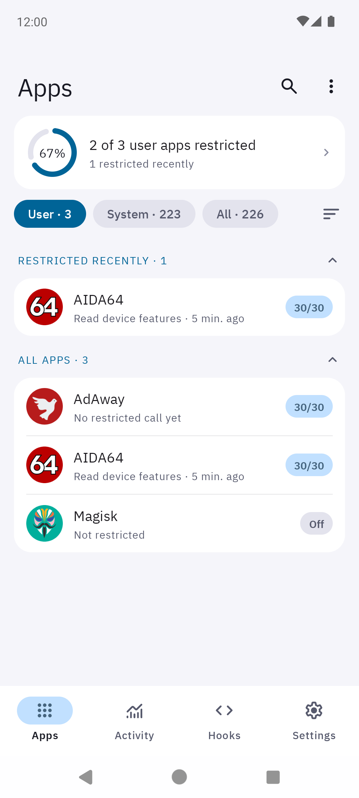
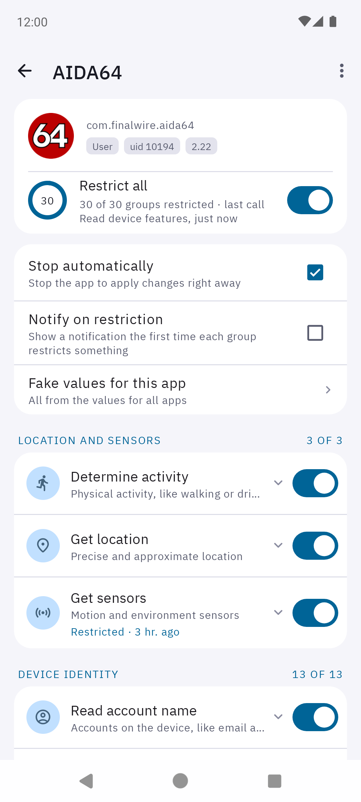
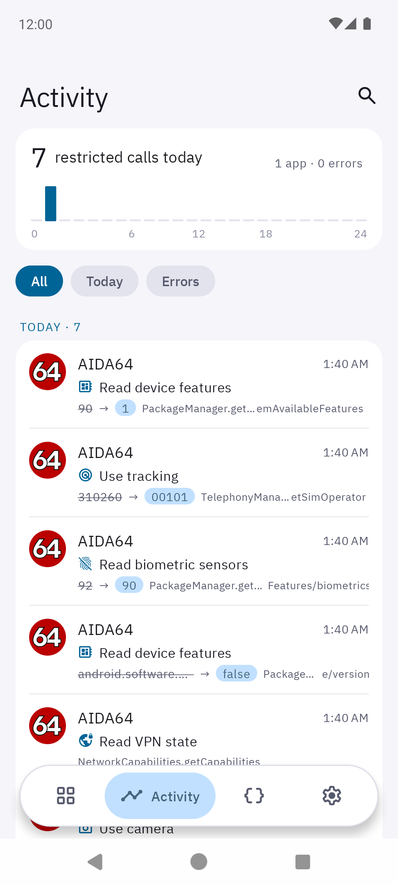
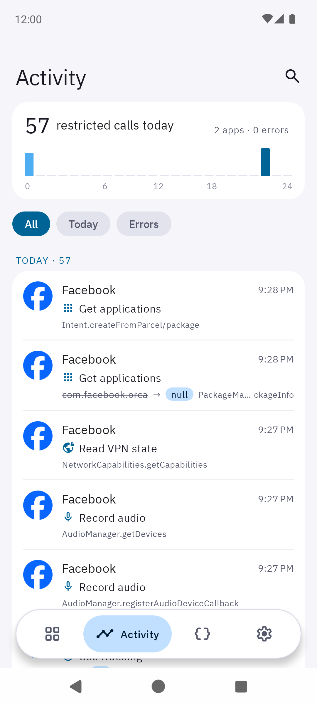
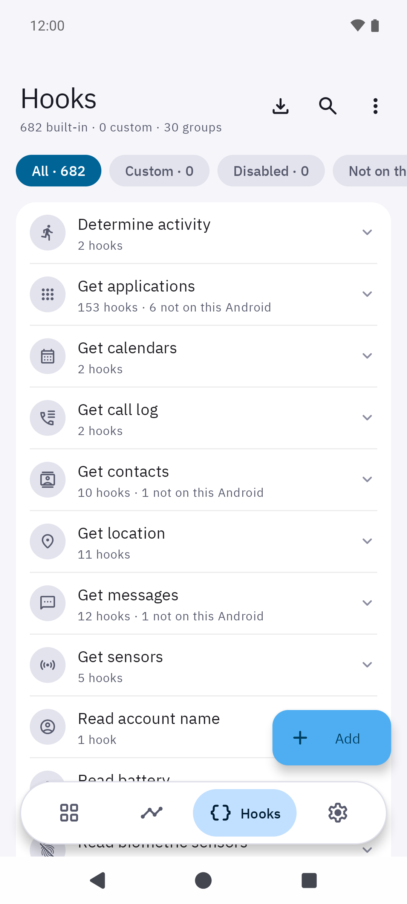
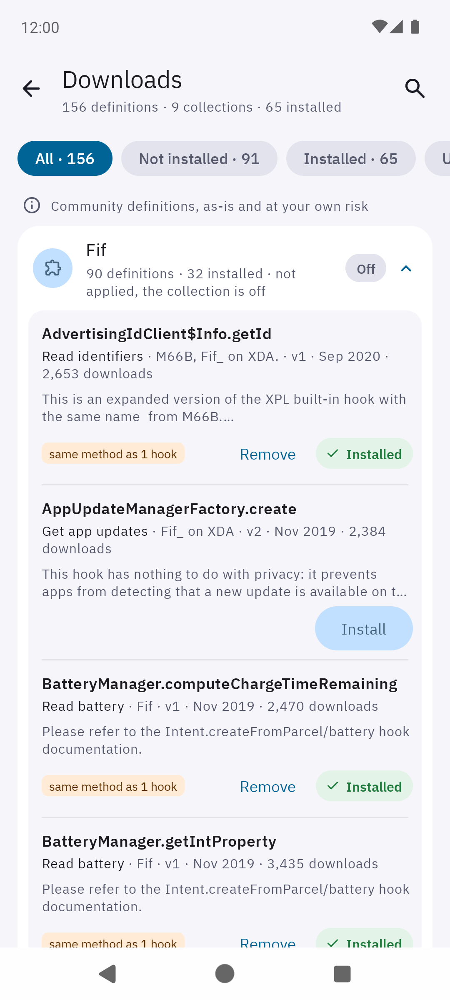
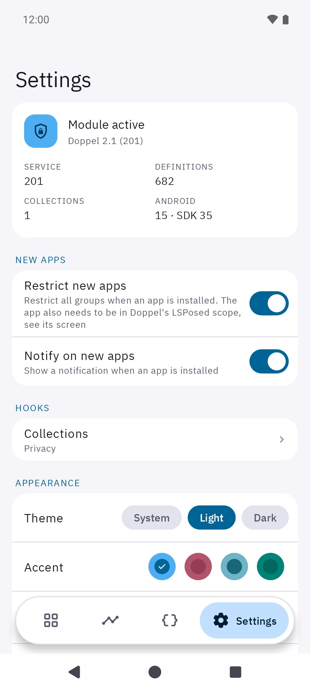
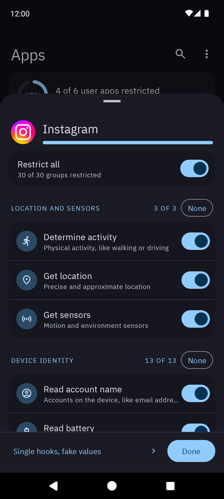

<p align="center">
  
</p>

<p align="center">
  <a href="https://github.com/akano12/Doppel/releases"></a>
  
  
  <a href="#license"></a>
  <a href="https://xdaforums.com/t/module-6-0-lsposed-doppel-fake-data-for-apps-maintained-continuation-of-xprivacylua.4806280/"></a>
</p>

<p align="center">
  <a href="#screenshots">Screenshots</a> ·
  <a href="#features">Features</a> ·
  <a href="#installation">Installation</a> ·
  <a href="#restrictions">Restrictions</a> ·
  <a href="FAQ.md">FAQ</a> ·
  <a href="#building">Building</a>
</p>

Doppel is a really simple to use privacy manager for Android 6 and later, the successor of
[XPrivacy](https://forum.xda-developers.com/xposed/modules/xprivacy-ultimate-android-privacy-app-t2320783).

Revoking Android permissions from apps often lets apps crash or malfunction.
Doppel solves this by feeding apps fake data instead of real data.

> Doppel is based on [XPrivacyLua](https://github.com/M66B/XPrivacyLua) by Marcel Bokhorst (M66B), which is not maintained anymore.
> It continues XPrivacyLua under a new name, with a new interface, updates for current Android versions and new restrictions,
> under the same license, the [GPL version 3](#license).

Why Doppel
----------

In German folklore, a doppelgänger, a "double-goer", is a person's ghostly twin:
it looks like you, walks like you, answers like you, and isn't you.

Doppel gives you that double, for every app on your phone.
When an app asks for your location, your contacts or your device ID, your double answers in your place.
The answers look real, so the app keeps working, but they lead nowhere and the app learns nothing true about you.

The logo shows the same idea: a sinister mask in front, an innocent face behind it.
Apps only ever meet the mask.

Screenshots
-----------

<table>
  <tr><td align="center"><br><sub>Apps</sub></td><td align="center"><br><sub>An app</sub></td><td align="center"><br><sub>Activity</sub></td><td align="center"><br><sub>Hooks</sub></td></tr>
  <tr><td align="center"><br><sub>Hook editor</sub></td><td align="center"><br><sub>Downloads</sub></td><td align="center"><br><sub>Settings</sub></td><td align="center"><br><sub>Dark theme</sub></td></tr>
</table>

Features
--------

* Simple to use
* Manage any user or system app
* Fake values for all apps or per app
* A log of what each app tried, with the real and the fake value
* [Extensible](DEFINE.md) with your own hook definitions and definitions shared by others
* Light and dark theme, accent colors, a pure black background and a choice of app icons
* Multi-user support
* Free and open source

### Using the app

* **Apps** shows the apps by what needs attention: apps with a failed hook, user apps installed in the last week
  without restrictions (restricted with one tap), apps restricted or restricting something in the last day, and all apps.
  Tap an app to restrict groups or single hooks, stop it automatically and set *Fake values for this app*.
* **Activity** shows which app triggered which restriction and when, with the real and the fake value, and hook errors,
  searchable by app or restriction; *View log* on the screen of an app shows the log of that app only.
  Tapping a restriction opens the screen of the app with its hook highlighted.
* **Hooks** lets you view, edit, enable, disable, add, import and export hook definitions,
  and install and remove definitions shared by others with *Downloads*,
  like a blocklist of domains and blockers of the Radar, Localytics and Ogury SDKs.
* **Settings** has restricting of and notifications on new apps, the collections of definitions,
  the theme, accent color and app icon, the fake values used for all apps (like the IMEI, Android ID, location and time zone),
  backup and restore of settings, custom hook definitions and restrictions, and clearing all restrictions and settings.
  A restore of a backup of an older version takes over the restrictions of renamed definitions, completes the
  restricted groups with the definitions added since, stops the apps of which restrictions changed and ends with a summary.

The (no longer available) pro companion app is not needed anymore.
To add your own restriction definitions, see [this FAQ](FAQ.md#user-content-faq8) and [DEFINE.md](DEFINE.md).

Compatibility
-------------

Doppel supports Android 6.0 Marshmallow and later, on smartphones and tablets.
For Android 4.0.3 Ice Cream Sandwich to Android 5.1.1 Lollipop there is [XPrivacy](https://github.com/M66B/XPrivacy/blob/master/README.md) (unsupported).

Doppel uses the [modern Xposed API](https://github.com/libxposed/api) (API 101 or later) when the framework provides it,
and the legacy Xposed API otherwise, for example with Xposed or EdXposed.

Installation
------------

1. Install [Magisk](https://www.xda-developers.com/how-to-install-magisk/)
2. Install and activate an Xposed framework:
   [LSPosed](https://github.com/LSPosed/LSPosed) or a compatible fork on Android 8.1 and later,
   [Xposed](http://forum.xda-developers.com/xposed) on Android 6 and 7
3. Download Doppel from the [releases](https://github.com/akano12/Doppel/releases), install it and activate it
4. Reboot

LSPosed: the scope needs to include *System Framework*, which hosts the Doppel service in the settings provider,
and each app you want to restrict, see [here](https://github.com/LSPosed/LSPosed/wiki/How-to-use-it#install--activate-modules).
With the legacy API, *Settings Storage* (com.android.providers.settings) needs to be in the scope too.

A build signed with another key than the official release cannot update it: uninstall the official release first.
XPrivacyLua by M66B, which Doppel replaces, needs to be uninstalled before installing Doppel:
both use the same service and data, so they cannot be active side by side.

Restrictions
------------

A restriction hides data (an empty list) or fakes it (an empty or fake value).
All technical details are in [hooks.json](app/src/main/assets/hooks.json).

* Determine activity (fake unknown activity, hide activity transitions, see [here](https://developers.google.com/location-context/activity-recognition/))
* Get applications (hide installed apps, launcher activities, broadcast receivers, [widgets](https://developer.android.com/reference/android/appwidget/AppWidgetManager.html), usage statistics and events, keyboards and accessibility services of other apps, also for lookups by user, by user id, of activities, services and content providers, package contexts, launch intents and the shell command pm; the content providers, services, screens and broadcasts of hidden apps cannot be reached, so apps cannot ask each other for the account signed in)
* Get calendars (hide calendars)
* Get call log (hide call log)
* Get contacts (hide contacts, optionally except (non) starred contacts, hide blocked numbers)
* Get location (fake location, without the real altitude, speed and bearing, block [NMEA](https://en.wikipedia.org/wiki/NMEA_0183) messages and raw GNSS measurements)
* Get messages (hide MMS, SMS, SIM, voicemail)
* Get sensors (hide all available sensors)
* Read [account](https://developer.android.com/reference/android/accounts/Account.html) name (fake name, mostly e-mail address)
* Read biometric sensors (no fingerprint sensor, face or iris unlock and no enrolled fingerprints, also the files of the fingerprint sensor in /sys; checks which include the screen lock stay)
* Read battery (level in steps of 10 percent, hide charge counter, current, energy, cycle count, voltage and temperature, battery saver appears off)
* Read clipboard (fake paste)
* Read debugging state (developer options and USB or wireless debugging appear off)
* Read memory and storage (total memory and storage rounded up to the sizes devices are sold with, free space rounded down to two digits, also in /proc/meminfo and for the shell command cat)
* Read device settings (settings people change, like the window and transition animation scale, screen timeout, proxy, alarm sound and automatic time zone, have the values of a new device; not the font scale, the animator duration scale and whether accessibility is on, because the framework gives apps their real values anyway)
* Read identifiers (fake build serial number, Android ID, advertising ID, Privacy Sandbox ad ID, app set ID, GSF ID, limit ad tracking, random SD card ids on each start of the app, Wi-Fi, Bluetooth and network interface MAC addresses, the Bluetooth addresses of connected input devices, the files of /sys with the permanent id of the chip and of the SD card or storage, like on Samsung devices, do not exist)
* Read notifications (fake [status bar notifications](https://developer.android.com/reference/android/service/notification/StatusBarNotification.html))
* Read network data (hide cell info, also the cell of the service state, Wi-Fi networks, paired and connected Bluetooth devices, fake Wi-Fi network name, also in the text of Wi-Fi and network info, block Bluetooth scans, network service discovery (NsdManager) and Wi-Fi Direct and Wi-Fi Aware discovery)
* Read sync data (hide [sync data](https://developer.android.com/training/sync-adapters/creating-sync-adapter.html))
* Read telephony data (fake IMEI, MEID, SIM serial number, phone number, voicemail number, type allocation code, etc)
* Read time zone (fake time zone, also the system property, setting *value.timezone*, default UTC)
* Read device features (hide all features but the ones listed in setting *features.keep*, also in the list of features and for the shell command pm; a name ending in * matches the features starting with it, like `android.hardware.camera*`; WebView keeps its feature, it does not start without it; hide external input devices, like keyboards and game controllers)
* Read VPN state (hide VPN transports, networks and interfaces)
* Record audio (prevent recording and speech recognition)
* Record video (prevent recording)
* Run commands (commands like su and id fail, except the programs allowed in Fake values, setting *commands.allowed*, like `getprop,uname`, and the command lines matching *commands.regex*)
* Send messages (prevent sending MMS, SMS, data)
* Use analytics ([Adjust](https://www.adjust.com/), [AppsFlyer](https://www.appsflyer.com/), [Facebook app events](https://developers.facebook.com/docs/reference/androidsdk/current/facebook/com/facebook/appevents/appeventslogger.html/), [Firebase Analytics](https://firebase.google.com/docs/analytics/), [Firebase Crashlytics](https://firebase.google.com/docs/crashlytics), [Mixpanel](https://mixpanel.com/), [Segment](https://segment.com/), [Amplitude](https://amplitude.com/), [Branch](https://www.branch.io/), [Microsoft Clarity](https://clarity.microsoft.com/), [Singular](https://www.singular.net/))
* Use camera (fake camera not available, hide cameras)
* Use tracking (fake user agent for [WebView](https://developer.android.com/reference/android/webkit/WebView.html) only, [Build properties](https://developer.android.com/reference/android/os/Build.html) including the security patch level, the same values for the system properties and the shell commands getprop, uname and /proc/version, network/SIM country/operator, also in the system properties, device and Bluetooth name, the install and update times of other apps, the times of the folders of the shared storage, which tell when the device was set up (both 2009-01-01, like the files of reproducible builds), the boot id of the kernel, which is the same for all apps until a restart, an id of its own for each app, also for the shell command cat, the files of /sys which name the hardware, like the light sensor calibration and the touchscreen, do not exist)

*Use analytics* and some hooks of other restrictions (the advertising ID of Google Play services and Huawei, the app set ID,
activity recognition and geofences) hook libraries inside the target app, which works only if the app was not
[obfuscated](https://developer.android.com/studio/build/shrink-code.html) in a way that renamed these libraries.
The other restrictions hook Android itself and always work.

### Limits

* Some apps will start the camera app to take pictures. This cannot be restricted and there is no need for this, because only you can take pictures in this scenario, not the app.
* Some apps will use [OpenSL ES for Android](https://developer.android.com/ndk/guides/audio/opensl-for-android.html) to record audio, an example is WhatsApp. Xposed cannot hook into native code, so this cannot be prevented.
* The get applications restriction does not hide the app itself, apps sharing its user id and system apps (also updated ones) from lookups of single apps and from lists of components, like the activities for an intent, keyboards and accessibility services, because the Android code running in apps, like WebView, needs them. The lists of installed apps and packages and of running processes and services keep only the app itself and apps sharing its user id. The content providers, services, screens and broadcasts of hidden apps answer like the app is not installed, except for a content uri another app handed to the restricted app with a grant, like a shared photo, which it can still open.
* /proc/meminfo, the boot id and the times of the folders of the shared storage are faked for apps reading them with Java, like with FileInputStream, File and java.nio, and with the shell command cat. Native code reads the real ones, like the shell commands stat and ls -l do for the times of the folders; the times of the files in the folders stay.
* The files of /sys which do not exist for restricted apps cannot be opened, read, listed or found with Java and with shell commands like cat. Native code can still read them.
* The network data restriction blocks discovery of devices in the local network through Android (network service discovery, Wi-Fi Direct and Wi-Fi Aware). Apps discovering devices with their own code over plain sockets, like with mDNS or SSDP, cannot be prevented from doing so.
* The telephony data restriction will result in apps seeing a fake IMEI. However, this doesn't change the IMEI address of your device.

Help
----

* Questions: see the [FAQ](FAQ.md)
* Support on Doppel: open an [issue](https://github.com/akano12/Doppel/issues)
* Support on Xposed: see the [Xposed forum](http://forum.xda-developers.com/xposed)

Doppel with [Island](http://forum.xda-developers.com/android/-t3366295) and similar apps is not supported.

Contributing
------------

**Documentation**: contributions to this document and the FAQ are preferred as
[pull requests](https://help.github.com/articles/creating-a-pull-request/).

**Translations**: Doppel is in English for now. Complete translations are welcome as pull requests of
*app/src/main/res/values-xx/strings.xml* (xx is the language code), translated from *app/src/main/res/values/strings.xml*.

**Source code**: please open an [issue](https://github.com/akano12/Doppel/issues) first to tell what your plans are,
then send a [pull request](https://help.github.com/articles/creating-a-pull-request/).
By contributing you agree to the license below, including the copyright.

Building
--------

Build with [Android Studio](http://developer.android.com/sdk/) or from the command line
with JDK 17 or later and the Android SDK (platform 37):

```
./gradlew assembleDebug        # debug build
./gradlew assembleRelease      # release build, signed when keystore.properties exists
./gradlew testDebugUnitTest    # validates the built-in hook definitions and Lua scripts
scripts/check-service.sh       # on a rooted device or emulator with Doppel: the service answers only whom it should
```

The release build is signed with the key described in *keystore.properties*
(storeFile, storePassword, keyAlias, keyPassword), next to this file.
Sign with the v1 and v2 schemes only, like the build does: LSPosed cannot read an APK with a v3 signature,
so the module would not load (with apksigner: `--v3-signing-enabled false --v4-signing-enabled false`).
There is no support on building.

Attribution
-----------

Doppel is based on [XPrivacyLua](https://github.com/M66B/XPrivacyLua) by Marcel Bokhorst (M66B), the successor of XPrivacy.

Doppel uses:

* [LuaJ](https://sourceforge.net/projects/luaj/). Copyright 2007-2013 LuaJ. All rights reserved. See [license](http://luaj.sourceforge.net/license.txt).
* [Glide](https://bumptech.github.io/glide/). Copyright 2014 Google, Inc. All rights reserved. See [license](https://raw.githubusercontent.com/bumptech/glide/master/LICENSE).
* [AndroidX](https://developer.android.com/jetpack/androidx). Copyright (C) 2011 The Android Open Source Project. See [license](https://android.googlesource.com/platform/frameworks/support/+/androidx-main/LICENSE.txt).
* [IBM Plex](https://github.com/IBM/plex) fonts. Copyright © 2017 IBM Corp. with Reserved Font Name "Plex". See [license](LICENSE-FONTS.txt) (SIL Open Font License 1.1).
* [Material Symbols](https://github.com/google/material-design-icons) icons. Copyright Google LLC. See [license](https://www.apache.org/licenses/LICENSE-2.0) (Apache License 2.0).

License
-------

[GNU General Public License version 3](https://www.gnu.org/licenses/gpl.txt)

Copyright (c) 2017-2022 Marcel Bokhorst. All rights reserved.<br>
Copyright (c) 2026 akano12. All rights reserved.

Doppel is free software: you can redistribute it and/or modify
it under the terms of the GNU General Public License as published by
the Free Software Foundation, either version 3 of the License, or
(at your option) any later version.

Doppel is distributed in the hope that it will be useful,
but WITHOUT ANY WARRANTY; without even the implied warranty of
MERCHANTABILITY or FITNESS FOR A PARTICULAR PURPOSE.  See the
GNU General Public License for more details.

You should have received a copy of the GNU General Public License
along with Doppel. If not, see [https://www.gnu.org/licenses/](https://www.gnu.org/licenses/).

Trademarks
----------

*Android and Google Play are trademarks of Google LLC.*
