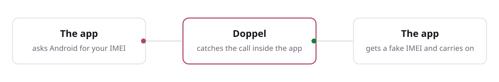
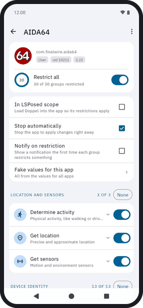
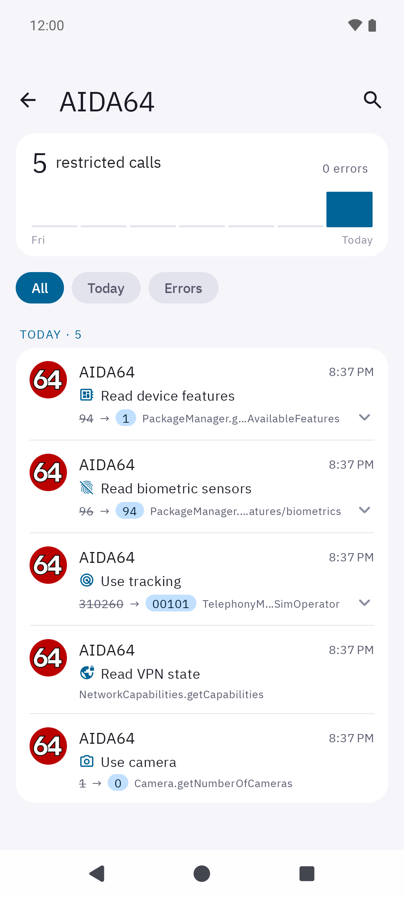
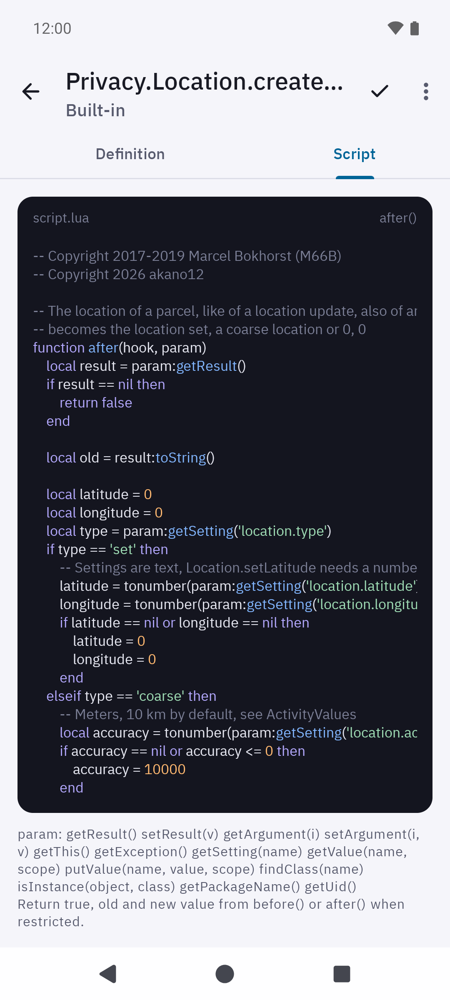

<p align="center">
  <picture>
    <source media="(prefers-color-scheme: dark)" srcset="docs/images/hero-dark.svg">
    
  </picture>
</p>

<p align="center">
  <a href="https://github.com/akano12/Doppel/releases"></a>
  
  
  <a href="#license"></a>
  <a href="https://xdaforums.com/t/module-6-0-lsposed-doppel-fake-data-for-apps-maintained-continuation-of-xprivacylua.4806280/"></a>
</p>

<p align="center">
  <a href="#features">Features</a> ·
  <a href="#screenshots">Screenshots</a> ·
  <a href="#installation">Install</a> ·
  <a href="#restrictions">Restrictions</a> ·
  <a href="FAQ.md">FAQ</a> ·
  <a href="#building">Building</a>
</p>

**Revoking a permission often makes an app crash. Doppel lets the app keep it and feeds it fake data instead**,
so the app keeps working and learns nothing true about you.

A doppelgänger is a person's ghostly twin: it looks like you, answers like you, and isn't you.
When an app asks for your location, contacts or device ID, your double answers in your place.

> [!NOTE]
> Doppel continues [XPrivacyLua](https://github.com/M66B/XPrivacyLua) by Marcel Bokhorst (M66B), which is not maintained anymore,
> with a new interface, updates for current Android versions and new restrictions, under the same license, the [GPL version 3](#license).

How it works
------------

<picture>
  <source media="(prefers-color-scheme: dark)" srcset="docs/images/how-it-works-dark.svg">
  
</picture>

Your real data never reaches the app. Each restricted call shows up under *Activity*, with the real and the fake value.

What an app sees
----------------

<picture>
  <source media="(prefers-color-scheme: dark)" srcset="docs/images/demo-dark.gif">
  
</picture>


| The app asks for             | Without Doppel     | With Doppel              |
|------------------------------|--------------------|--------------------------|
| IMEI, serial, Android ID     | the real ones      | fakes, new each boot     |
| Location                     | where you are      | a place you choose       |
| Contacts, calendar, call log | all of them        | hidden                   |
| Other apps                   | all of them        | hidden                   |
| Time since boot              | same in every app  | different per app        |
| Battery                      | 84%, charging      | 80%, no charging details |
| Clipboard                    | what you copied    | a fake paste             |
| `getprop`, `pm`, `cat`       | the real values    | the same fakes           |

In the demo, AIDA64 joins Doppel's LSPosed scope from its own screen: approve the request, and *Restrict all* applies every group. Each call it makes then gets the fake values.

<br clear="left">

Features
--------

<picture>
  <source media="(prefers-color-scheme: dark)" srcset="docs/images/features-dark.svg">
  
</picture>

Screenshots
-----------

<table>
  <tr><td align="center"><br><sub>App list</sub></td><td align="center"><br><sub>Per-app restrictions</sub></td><td align="center"><br><sub>Fake values</sub></td><td align="center"><br><sub>Restriction activity</sub></td><td align="center"><br><sub>Hooks</sub></td></tr>
  <tr><td align="center"><br><sub>Downloads</sub></td><td align="center"><br><sub>Settings</sub></td><td align="center"><br><sub>Quick restrict</sub></td><td align="center"><br><sub>App log</sub></td><td align="center"><br><sub>Hook editor</sub></td></tr>
</table>

Installation
------------

Doppel needs Android 8.1 or later and a rooted device with an Xposed framework.
It uses the [modern Xposed API](https://github.com/libxposed/api) when the framework has it, else the legacy API.

1. Install [Magisk](https://www.xda-developers.com/how-to-install-magisk/)
2. Install and activate an Xposed framework: [LSPosed](https://github.com/LSPosed/LSPosed) or a compatible fork
3. Install Doppel from the [releases](https://github.com/akano12/Doppel/releases) and activate it
4. Reboot

> [!IMPORTANT]
> In LSPosed, the scope needs *System Framework*, which hosts the Doppel service, and each app you want to restrict;
> with the legacy API (like EdXposed) also *Settings Storage*.
> Add only apps you restrict: LSPosed is loaded into every app in the scope.
> *In LSPosed scope* on the screen of an app adds it for you.

> [!WARNING]
> Uninstall XPrivacyLua first: both use the same service and data.
> A build signed with another key than the official release cannot update it; uninstall the official release first.

Restrictions
------------

A restriction hides data (an empty list) or fakes it (an empty or fake value).
The faked values are the same for the shell commands apps run, like getprop, pm and cat.
The details are in [hooks.json](app/src/main/assets/hooks.json).

<details>
<summary><b>Who you are</b> · 5 groups</summary>

* **Read account name**: fake name
* **Read biometric sensors**: no fingerprint sensor, face or iris unlock
* **Read identifiers**: fake serial, Android ID, advertising and app set ID, MAC addresses;
  the permanent ids of the chip, SD card and storage in /sys do not exist
* **Read telephony data**: fake IMEI, MEID, SIM serial, phone number and more
* **Use tracking**: fake device model and build, operator, device name, WebView user agent, install times of other apps,
  boot id, the boot time (each app sees its own, so the time since boot no longer links apps across restarts) and the
  folder times that tell when the device was set up; the hardware files in /sys do not exist

</details>

<details>
<summary><b>Where you are</b> · 4 groups</summary>

* **Determine activity**: fake unknown activity, no activity transitions
* **Get location**: fake location, no NMEA messages or raw GNSS measurements
* **Get sensors**: hide them
* **Read time zone**: fake time zone, *value.timezone*, default UTC

</details>

<details>
<summary><b>Your data</b> · 7 groups</summary>

* **Get calendars**, **Get call log**: hide them
* **Get contacts**: hide contacts, optionally except (non) starred ones, and blocked numbers
* **Get messages**: hide SMS, MMS, SIM messages and voicemail
* **Read clipboard**: fake paste
* **Read notifications**: hide the notifications of other apps
* **Read sync data**: hide sync data

</details>

<details>
<summary><b>Your device and apps</b> · 8 groups</summary>

* **Get applications**: hide other apps, their components, widgets and usage statistics; hidden apps cannot be reached
* **Read battery**: level in steps of 10 percent, at least 15, no charge details, battery saver off
* **Read debugging state**: developer options and USB or wireless debugging off
* **Read device features**: only the features in *features.keep*, no external keyboards and game controllers
* **Read device settings**: the values of a new device, like the animation scale and the screen timeout
* **Read memory and storage**: sizes rounded like devices are sold, free space rounded down
* **Read network data**: hide cells, Wi-Fi networks, Bluetooth devices and local network discovery, fake Wi-Fi name
* **Read VPN state**: no VPN

</details>

<details>
<summary><b>Recording</b> · 3 groups</summary>

* **Record audio**, **Record video**: prevent recording, also speech recognition
* **Use camera**: no camera

</details>

<details>
<summary><b>Actions and analytics</b> · 3 groups</summary>

* **Run commands**: commands fail, except the programs in *commands.allowed* (like `getprop,uname`)
  and the command lines matching *commands.regex*
* **Send messages**: prevent sending SMS, MMS and data messages
* **Use analytics**: Adjust, AppsFlyer, Facebook app events, Firebase Analytics and Crashlytics, Mixpanel, Segment,
  Amplitude, Branch, Microsoft Clarity, Singular

</details>

### Limits

<details>
<summary>What Doppel cannot do</summary>

* Xposed cannot hook native code: audio recorded with OpenSL ES, like WhatsApp does, and files read natively,
  like by shell commands such as stat and ls, are not restricted.
* *Use analytics* and some other hooks hook libraries inside apps, which only works when the app did not
  [obfuscate](https://developer.android.com/studio/build/shrink-code.html) their names.
* *Get applications* keeps the app itself, apps sharing its user id and system apps visible to lookups of single apps,
  because the Android code running in apps, like WebView, needs them.
* Discovery of local devices with the app's own sockets, like mDNS or SSDP, cannot be prevented.
* The paths of other apps, like `/data/app/~~…==/com.example-…==/base.apk`, stay: Android reads their icons and labels
  from these files inside the app. They differ per install, so restrict *Get applications* to hide other apps entirely.
* The fake boot time shifts only the time-since-boot clock (elapsedRealtime), by its own amount per app. The wall clock
  and the uptime clock are left alone, because faking them breaks input events and secure connections; so an app can
  still link itself within one awake session (until the device sleeps) from the wall clock minus the uptime. A location
  fix's time and elapsed-time alarms are corrected to the shift, so a fix reads as fresh and alarms still fire on time,
  but timestamps the system reports on that clock in other ways are not: sensor events and camera frames can read as
  the shift old, and a media app's progress bar on the lock screen can be off by the shift. This stops apps that read
  the boot time without knowing Doppel, which is how trackers link apps; an app written to defeat Doppel can read its
  own offset the same way its hooks do and undo the shift, like it can tell Doppel is there.
* Restricted apps can detect Doppel, but cannot change anything, see [the FAQ](FAQ.md#user-content-faq21).
* Apps with root access can get around any restriction.

</details>

Help
----

* Questions: see the [FAQ](FAQ.md)
* Problems with Doppel: open an [issue](https://github.com/akano12/Doppel/issues)
* Problems with Xposed: see the [Xposed forum](http://forum.xda-developers.com/xposed)

Doppel with [Island](http://forum.xda-developers.com/android/-t3366295) and similar apps is not supported.

Contributing
------------

Pull requests are welcome for the documentation.
For code, please open an [issue](https://github.com/akano12/Doppel/issues) first.
Definitions to share go into Downloads, see [here](docs/DEFINE.md#sharing).
By contributing you agree to the license below.

Building
--------

<details>
<summary>Build from source</summary>

With [Android Studio](http://developer.android.com/sdk/), or from the command line with JDK 17 or later and the Android SDK (platform 37):

```
./gradlew assembleDebug        # debug build
./gradlew assembleRelease      # release build, signed when keystore.properties exists
./gradlew testDebugUnitTest    # checks the hook definitions and scripts
scripts/test-on-device.sh      # on a device or emulator: the tests of shell commands, which Windows skips
scripts/check-service.sh       # on a rooted device or emulator with Doppel: whom the service answers
```

*keystore.properties* (storeFile, storePassword, keyAlias, keyPassword) goes next to this file.
Sign with the v1 and v2 schemes only, like the build does: LSPosed cannot read an APK with a v3 signature.

</details>

Attribution
-----------

Doppel is based on [XPrivacyLua](https://github.com/M66B/XPrivacyLua) by Marcel Bokhorst (M66B).

<details>
<summary>Doppel uses</summary>

* [LuaJ](https://sourceforge.net/projects/luaj/). Copyright 2007-2013 LuaJ. All rights reserved. See [license](http://luaj.sourceforge.net/license.txt).
* [Glide](https://bumptech.github.io/glide/). Copyright 2014 Google, Inc. All rights reserved. See [license](https://raw.githubusercontent.com/bumptech/glide/master/LICENSE).
* [AndroidX](https://developer.android.com/jetpack/androidx). Copyright (C) 2011 The Android Open Source Project. See [license](https://android.googlesource.com/platform/frameworks/support/+/androidx-main/LICENSE.txt).
* [libxposed service](https://github.com/libxposed/service). See [license](https://github.com/libxposed/service/blob/master/LICENSE) (Apache License 2.0).
* [IBM Plex](https://github.com/IBM/plex) fonts, also in the images of this page. Copyright © 2017 IBM Corp. with Reserved Font Name "Plex". See [license](LICENSE-FONTS.txt) (SIL Open Font License 1.1).
* [Material Symbols](https://github.com/google/material-design-icons) icons, also in the images of this page. Copyright Google LLC. See [license](https://www.apache.org/licenses/LICENSE-2.0) (Apache License 2.0).

</details>

License
-------

Copyright (c) 2017-2022 Marcel Bokhorst. All rights reserved.<br>
Copyright (c) 2026 akano12. All rights reserved.

Doppel is free software under the [GNU General Public License version 3](LICENSE) or (at your option) any later version,
without any warranty.

*Android and Google Play are trademarks of Google LLC.*
