<p align="center">
  <picture>
    <source media="(prefers-color-scheme: dark)" srcset="docs/images/hero-dark.svg">
    
  </picture>
</p>

<p align="center">
  <a href="https://github.com/akano12/Doppel/releases"></a>
  
  
  <a href="#license"></a>
  <a href="https://xdaforums.com/t/module-6-0-lsposed-doppel-fake-data-for-apps-maintained-continuation-of-xprivacylua.4806280/"></a>
</p>

<p align="center">
  <a href="#features">Features</a> ·
  <a href="#screenshots">Screenshots</a> ·
  <a href="#installation">Install</a> ·
  <a href="#restrictions">Restrictions</a> ·
  <a href="FAQ.md">FAQ</a> ·
  <a href="#building">Building</a>
</p>

**Revoking a permission often makes an app crash. Doppel lets the app keep it and feeds it fake data instead**,
so the app keeps working and learns nothing true about you.

A doppelgänger is a person's ghostly twin: it looks like you, answers like you, and isn't you.
When an app asks for your location, contacts or device ID, your double answers in your place.

> [!NOTE]
> Doppel continues [XPrivacyLua](https://github.com/M66B/XPrivacyLua) by Marcel Bokhorst (M66B), which is not maintained anymore,
> with a new interface, updates for current Android versions and new restrictions, under the same license, the [GPL version 3](#license).

How it works
------------

<picture>
  <source media="(prefers-color-scheme: dark)" srcset="docs/images/how-it-works-dark.svg">
  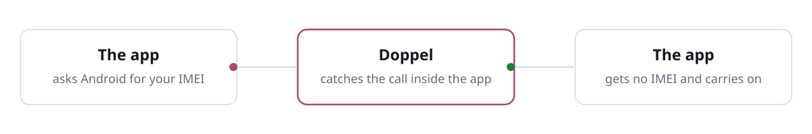
</picture>

Your real data never reaches the app. Each hook that restricted an app shows up under *Activity*, with the time of its last restriction and the real and the fake value.

What an app sees
----------------

<picture>
  <source media="(prefers-color-scheme: dark)" srcset="docs/images/demo-dark.gif">
  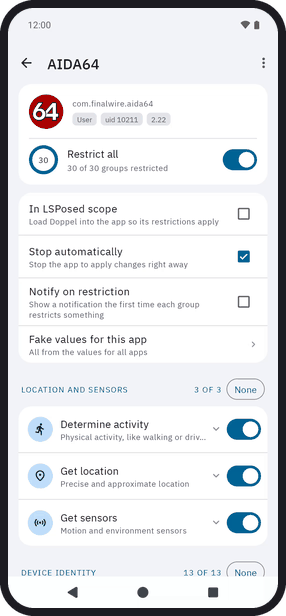
</picture>


| The app asks for             | Without Doppel     | With Doppel              |
|------------------------------|--------------------|--------------------------|
| Android ID                   | the real one       | a fake which stays       |
| IMEI                         | the real one       | none                     |
| Serial number                | the real one       | unknown                  |
| Location                     | where you are      | a place you choose       |
| Contacts, calendar, call log | all of them        | hidden                   |
| Other apps                   | all of them        | hidden                   |
| Battery                      | 84%, charging      | 80%, no charging details |
| Clipboard                    | what you copied    | nothing copied           |
| `getprop`, `pm`, `cat`       | the real values    | refused                  |

In the demo, AIDA64 joins Doppel's LSPosed scope from its own screen: approve the request, and *Restrict all* applies every group. Each call it makes then gets the fake values.

<br clear="left">

Features
--------

<picture>
  <source media="(prefers-color-scheme: dark)" srcset="docs/images/features-dark.svg">
  
</picture>

Screenshots
-----------

<table>
  <tr><td align="center">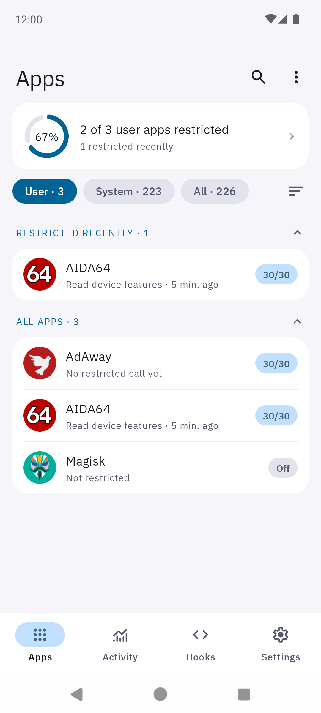<br><sub>App list</sub></td><td align="center">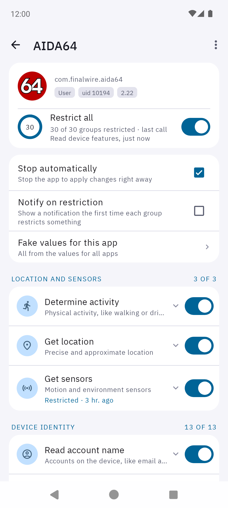<br><sub>Per-app restrictions</sub></td><td align="center">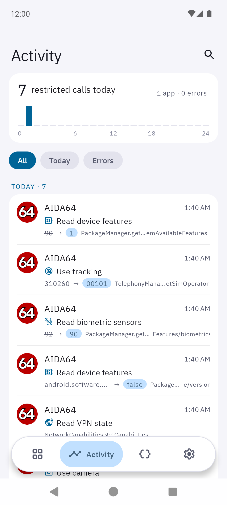<br><sub>Fake values</sub></td><td align="center">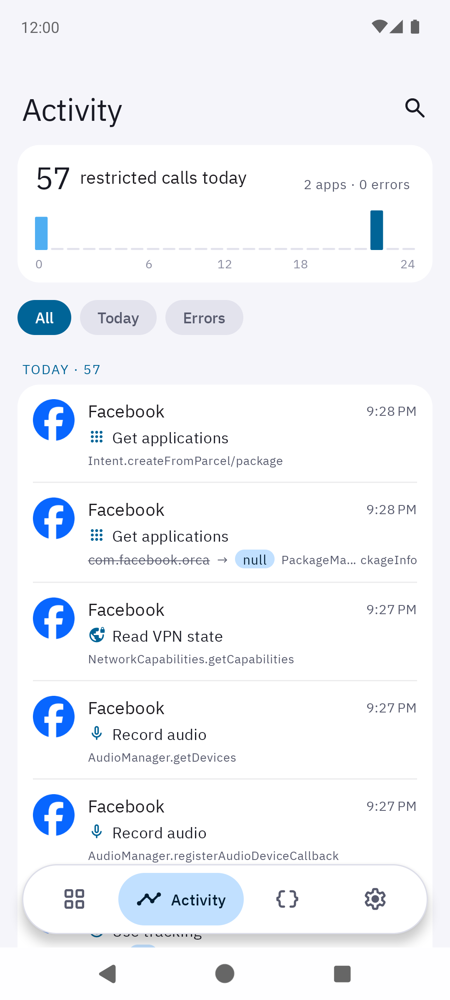<br><sub>Restriction activity</sub></td><td align="center">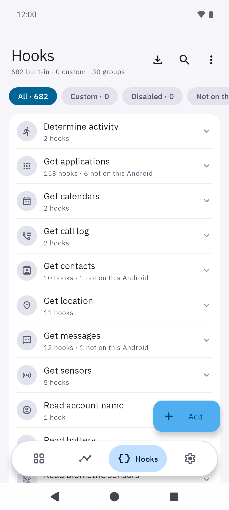<br><sub>Hooks</sub></td></tr>
  <tr><td align="center">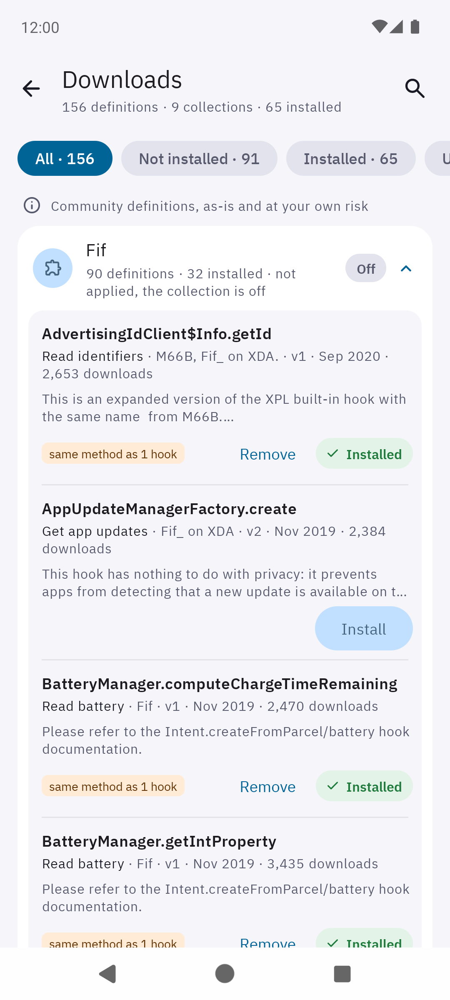<br><sub>Downloads</sub></td><td align="center">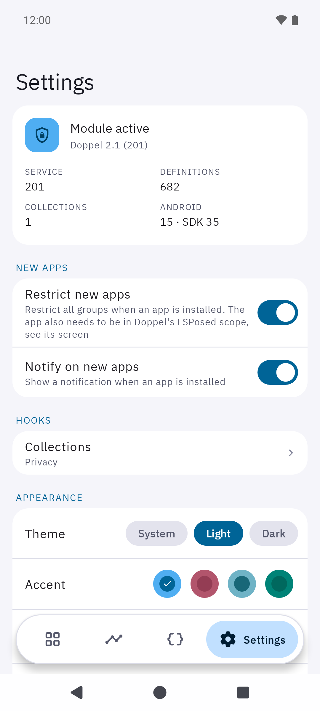<br><sub>Settings</sub></td><td align="center">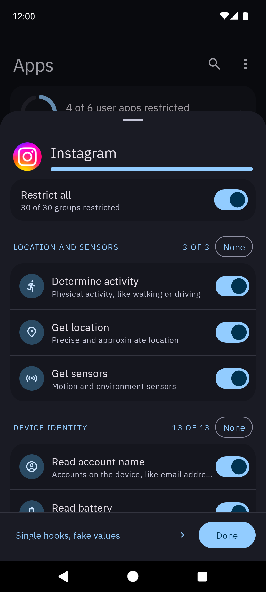<br><sub>Quick restrict</sub></td><td align="center">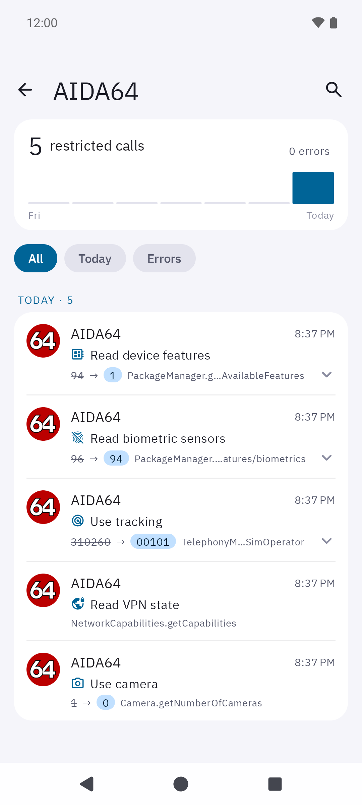<br><sub>App log</sub></td><td align="center">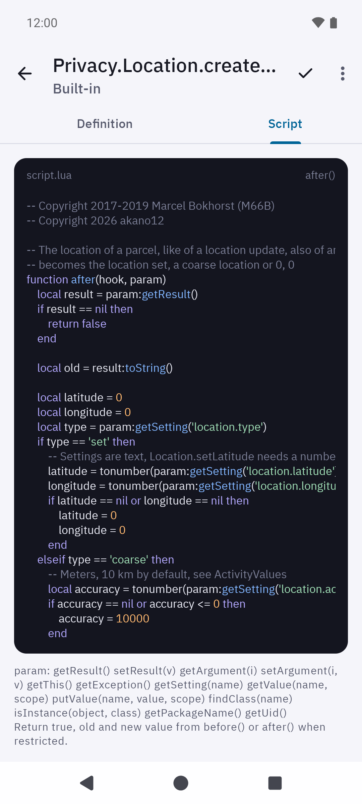<br><sub>Hook editor</sub></td></tr>
</table>

Installation
------------

Doppel needs Android 9 or later and a rooted device with an Xposed framework.
It uses the [modern Xposed API](https://github.com/libxposed/api) (version 101 or later) when the framework has it, else the legacy API.

1. Root the device, like with [Magisk](https://topjohnwu.github.io/Magisk/install.html)
2. Install and activate an Xposed framework: [LSPosed](https://github.com/LSPosed/LSPosed) or a compatible fork
3. Install Doppel from the [releases](https://github.com/akano12/Doppel/releases) and enable it in the framework
4. Reboot

> [!IMPORTANT]
> In LSPosed, the scope needs *System Framework*, which hosts the Doppel service, and each app you want to restrict;
> with the legacy API (like EdXposed) also *Settings Storage*.
> Add only apps you restrict: LSPosed is loaded into every app in the scope.
> With the modern API, *In LSPosed scope* on the screen of an app adds it for you.

### Work profiles and other users

Doppel supports work profiles and other users: each has its own restricted apps, fake values and settings, and apps
cannot read those of another one. For a profile or user:

1. Install Doppel in it too, like from an app store in the profile, or with
   `adb shell pm install-existing --user <id> sk.akano12.doppel`
2. In LSPosed, enable Doppel for that user and add its apps to the scope; *System Framework* of the owner is enough
3. Open Doppel in the profile or user (the one with the briefcase for a work profile) to restrict its apps

With *Use tracking*, restricted apps are not told about the other users and profiles of the device.

> [!WARNING]
> Uninstall XPrivacyLua first: both use the same service and data.
> A build signed with another key than the official release cannot update it; uninstall the official release first.

Restrictions
------------

A restriction hides data (an empty list) or fakes it (an empty or fake value).
An app restricted by *Run commands*, or by a group whose values commands could read, cannot run system programs or
shells, like getprop, pm, cat or sh: each command fails like a program the app may not run (`IOException`, error=13,
Permission denied), and `File.canExecute`, `Os.access` and `Files.isExecutable` say no for it too, so the values cannot be read past the fakes. Programs which come in the app's own native library folder still run: they are native code of the app,
which Doppel does not cover anyway.
The details are in [hooks.json](app/src/main/assets/hooks.json).

<details>
<summary><b>Who you are</b> · 5 groups</summary>

* **Read account name**: fake name, also in contacts and calendars
* **Read biometric sensors**: no fingerprint sensor, face or iris unlock, also in the prompt of biometrics
* **Read identifiers**: serial unknown unless you set one, Android ID (one for each developer which stays the same, like Android gives it,
  or new each boot if you choose so), DRM id (one for each app which stays the same, like the one of Widevine),
  advertising and app set ID, MAC addresses, ids of file systems made of their UUID;
  the permanent ids of the chip, SD card and storage in /sys do not exist, and neither do the advertising ids (OAID)
  of the services of device makers (Samsung, Lenovo, Asus, OPPO, OnePlus, realme, Honor, Huawei, Coolpad, Nubia,
  Freeme and 360, also any service with one of their interfaces), the ids they and SDKs keep in the settings
  (Huawei, Honor, Xiaomi, OnePlus, Amazon Fire OS, Baidu) and the SIM serial in their system properties, nor does
  the install referrer of the Play Store (the ad click the app's install came from);
  the GSF id of Google services is hidden from every app but Play services and the services framework themselves,
  also from the Play Store and the other apps of Google, which see none like on a device which never checked in and
  may lose functions which need it;
  the app set ID service of Play services cannot be bound, so its library makes an id of the app itself, like
  without Play services
* **Read telephony data**: no IMEI or MEID unless you set one (then each SIM slot has its own, of the same model),
  no ESN, fake phone number and more, also in the phone accounts of the SIMs and in the calls of the call log; no SIM
  serial (ICCID) or subscriber id (IMSI), like Android 11 and later give apps without privileges (Android 10 and later
  for the SIM serial and IMSI); up to Android 12, where the phone account of a SIM is named by its serial, no SIMs are
  listed, neither as subscriptions nor as phone accounts, like for an app whose phone state access is turned off, with
  no service state and an unknown type of the mobile network, except to the phone process, Settings and the system UI,
  while the ids, slots and states of the SIMs stay, and so do their rows in the telephony provider, without their
  serial, card id and IMSI
* **Use tracking**: fake device model and build (unknown, which Android gives for a value that is not set, with the
  fingerprint Android makes of them and no fingerprints of the partitions), no security patch, also in the keys of
  the app, and no key attestation, operator, device name, WebView user agent, kernel (the release and build of the
  newest AOSP kernel of the same version), install times of other apps,
  boot id and the folder times and inodes that tell when the device was set up; the hardware files in /sys, the
  property files of the partitions, the GPU drivers and the vendor's HAL manifests, SELinux contexts and display
  configuration do not exist, nor do
  the speeds, caches and idle states of the processors (8 equal processors in one cluster, also in /proc/cpuinfo and
  their uevent and modalias files, each with the same common ARM core and only its instructions), and the fonts of
  device makers are not listed,
  also in the font configuration; codec names, the GPU and OpenGL extensions without the vendor of the chip, the camera
  without the version of its hardware; the app's memory maps without the vendor's libraries and the mount tables and
  file stores without the storage controller; other users and work profiles, user-installed certificates (also among
  the issuers the app's trust manager accepts), the heat, the vibrator, the audio buffer, the rounded corners and the
  shape of the screen like on a plain device, apart from the framework resources of the screen (see Limits); the
  system certificates the user disabled are listed, and there is no screen lock and so no enrolled fingerprint or face,
  so apps which need one refuse to work or to make keys that need it (keys made before keep working, unless *Read
  biometric sensors* is restricted too, which ends the keys of a fingerprint or face); the device is never locked, like
  a device without a lock, so an app may show its content on the locked screen, and an app may still see the lock in a
  prompt that allows it

</details>

<details>
<summary><b>Where you are</b> · 5 groups</summary>

* **Determine activity**: fake unknown activity, detected at the moment the app reads it, no activity transitions or
  sleep events of Play services, also in apps that obfuscated it; the requests of Play services for them, by its client
  and by the older `ActivityRecognitionApi`, are accepted without registering, so nothing arrives when the user moves
  or wakes up, and answer like without Doppel for an app without the permission (from Android 10 the one of Android,
  before it the one of Play services), for an interval below 0 or on a device without Play services. The results of a
  registration from before the restriction which the app does not repeat reach no receivers, except registered ones of
  an ordered broadcast or, from Android 14, one Android waits for, which like a service get the fake unknown activity.
  Requests of HMS still deliver, with the results faked; Awareness gives the fake unknown activity, but its activity
  fences still follow the real activity
* **Get location**: fake location, no geofence events (their receivers are not called, except registered ones of an ordered broadcast or, from Android 14, one Android waits for, which like a service get an event without a transition or fences), no NMEA messages or raw GNSS measurements, no location of Wi-Fi access points (RTT), and no location of photos and videos, except those the app ships in its own APK.
  Do not restrict it for camera, gallery and photo editing apps whose photos should keep their location: what such
  an app saves, like an edited copy, is saved without it
* **Get sensors**: hide them, also as features of the device, and dynamic sensors, like the head tracker of headphones; the proximity sensor cannot turn the screen off
* **Read languages**: fake languages, *Languages* in *Fake values*, default en-US, also in system properties,
  the settings and the configuration of the app; no region of sale (Samsung, Xiaomi); only keyboard languages of the
  fake ones, also in the settings; no broadcast when the languages change. The app keeps the language chosen for it,
  else it shows its texts in a fake language
* **Read time zone**: fake time zone, *Time zone* in *Fake values*, default UTC, also for the local time of native code,
  like SQLite, Flutter and JNI libraries

</details>

<details>
<summary><b>Your data</b> · 8 groups</summary>

* **Get calendars**: hide them
* **Get call log**: hide it, also the number of incoming and outgoing calls
* **Get contacts**: hide contacts, optionally except (non) starred ones, and blocked numbers
* **Get messages**: hide SMS, MMS, SIM messages and voicemail
* **Read clipboard**: nothing copied, except the app's own copies
* **Learn typing**: ask the keyboard not to learn what is typed, like in incognito mode; keyboards can ignore it
* **Read notifications**: hide the notifications and media sessions of other apps
* **Read sync data**: hide sync data

</details>

<details>
<summary><b>Your device and apps</b> · 8 groups</summary>

* **Get applications**: hide other apps, their components, widgets, accounts, install sessions, package changes,
  keyboards and accessibility services, also in the permission files of the system and the folders of system apps and
  overlays; the current keyboard of a hidden app becomes the one Android would choose without it and its spell checker
  the first one of the system, and when no keyboard is left the system keyboards are enabled, like Android enables them
  then, else there is none; hidden apps cannot be reached, their providers cannot be observed, and they are not named as
  the maker of a PendingIntent, as the default browser, as the autofill service (autofill is then off in the app, like
  with none set) or as the users of a shared library; the installs, updates, removals, restarts and suspensions of other
  apps, system apps too, send the app no broadcasts; usage access reads as not granted, so the usage statistics, events,
  event counts and configurations are empty, the standby buckets and storage of other apps and the storage of the user
  are refused, and the data usage has only the app's own traffic, with the device summary and other apps and the system
  refused, like for an app without it, except that an app with usage access also gets none of its own events;
  accessibility services of system apps are hidden too, also from the services and lookups of PackageManager, and so
  are the accessibility shortcuts of Android itself, like color inversion, in the settings, and accessibility and touch
  exploration are off when only hidden services turn them on
* **Read battery**: level in steps of 10 percent, at least 15, no charge details but the time to full of a typical
  charger instead of the real one, battery saver off
* **Read debugging state**: developer options (also Stay awake and the log buffer sizes) and USB or wireless debugging off, a user build signed with release keys which is not debuggable, also in the build fingerprint; the files of su, Magisk and Xposed and the property files of the partitions do not exist
* **Read device features**: only the features in *Shown device features* (*Fake values*), the ones Android adds on every device (the RAM class and app enumeration) and the ones apps see working anyway: the touch screen with multitouch, Wi-Fi, telephony (its radio, data, SIMs, calls and messages, but not eSIM or IMS) and WebView; without their features there is no Wi-Fi Direct, Aware, RTT or MIDI manager, consumer IR manager from Android 14, Bluetooth adapter or NFC adapter either, like on a device without them, WifiManager tells no Wi-Fi Direct or RTT, the IR manager of older versions no emitter and sends nothing, and their broadcasts reach no receiver; no external keyboards and game controllers, also not in the configuration (keys and navigation, like on a phone without them) and not in whether the device has a key; the feature and permission files of the system do not exist, but for the ones every Android has in /system/etc, like platform.xml and the files of the libraries of Android, and their folders, and the folders permissions of the other partitions with the files named after the features shown, like android.hardware.wifi.xml. The features of the camera, microphone, sensors and biometric sensors are left to *Use camera*, *Record audio*, *Get sensors* and *Read biometric sensors*
* **Read device settings**: the values of a new device, like the animation scale and the screen timeout; no ringtone,
  notification or alarm sound, like when None was chosen, also not in the copies Android plays them from
* **Read memory and storage**: totals a fixed share below the sizes devices are sold with, the size of the device and
  its advertised memory like Android derives them from these, without the memory size of the bootloader, free space
  rounded down and never above its total, free memory rounded down in whole pages, the low memory thresholds Android
  gives a device without the settings of its maker, and the memory apps may use rounded down to a common step
* **Read network data**: hide cells, Wi-Fi networks, Bluetooth devices (also in broadcasts) and local network discovery,
  fake Wi-Fi name up to Android 11 and none from Android 12
* **Read VPN state**: no VPN, also without its routes and search domains and the settings of always-on VPN, also in
  a parcel of the capabilities, network info or link properties of the network, which compare like that parcel; a VPN
  app cannot start its tunnel, like one the user has not allowed, so with a restricted always-on VPN the traffic goes
  out without the VPN, and with lockdown the device is offline; a platform (IKEv2) VPN made always-on, or started before
  the restriction, still runs

</details>

<details>
<summary><b>Recording</b> · 3 groups</summary>

* **Record audio**, **Record video**: prevent recording, also speech recognition; a started AudioRecord gives silence,
  like a microphone another app took; of the audio devices only the built-in ones without a microphone are left,
  also for calls; *Record audio* also hides the microphone feature, connected headsets and the screens of other apps
  which record for the app, speech recognizers and sound recorders, also in a chooser or through a PendingIntent, like
  on a device without one; a MediaRecorder recording ends like one which got no data: `stop()` throws `stop failed.`
  (except for WebM, MPEG-2 TS and RTP), and an app which does not catch it crashes; *Record video* also prevents screen
  capture: the app gets the answer of a user declining it, so it captures neither the screen nor the sound other apps
  play
* **Use camera**: no camera, also not as a feature of the device, and no torch; a MediaRecorder with the camera as
  source throws `start failed.` at `start()`, like on a device without a camera

</details>

<details>
<summary><b>Actions and analytics</b> · 3 groups</summary>

* **Run commands**: commands fail, like `su`, `id` or `getprop`, except programs in the app's own native library
  folder. *Read biometric sensors*, *Get sensors*, *Read identifiers*, *Use tracking*, *Read languages*, *Read time zone*,
  *Get applications*, *Read debugging state*, *Read device features*, *Read memory and storage*, *Read network
  data*, *Read telephony data* and *Read VPN state* refuse commands the same way, since commands could read their
  values; only *Get applications*, *Read telephony data* and *Use tracking* also refuse, like *Run commands*, the
  programs an app starts by reflection beneath ProcessBuilder and Os, which Android 8.1 allows without any trick
* **Send messages**: prevent sending SMS, MMS and data messages
* **Use analytics**: Adjust, AppsFlyer, Facebook app events, Firebase Analytics (without consent, so no app
  instance id), Crashlytics and Performance Monitoring, Google Analytics v4, Mixpanel, Segment, Amplitude, Branch,
  Microsoft Clarity, Sentry, Singular, Umeng; Unity Ads without consent for personalized ads, AppLovin and LevelPlay
  (ironSource) without it and with do not sell, Amazon Publisher Services without consent and location; OneSignal
  requires consent and has none, so it sends nothing and the app gets no push messages through it either; Bugsnag
  enables no release stage, so it sends no errors or sessions; the consent strings of IAB TCF and GPP a consent tool of
  the app stored are not there, and GDPR applies wherever the tool stored any of them, so ad SDKs which read them have no
  consent, and Amazon then reads no advertising id and keeps nothing stored; a consent tool which reads them back may
  ask again

</details>

### Limits

<details>
<summary>What Doppel cannot do</summary>

* Xposed cannot hook native code: audio recorded with OpenSL ES, like WhatsApp does, and files read natively
  are not restricted. Native code also sees the real system properties, languages, codecs, GPU, processors, fonts and
  sensors, and can start processes itself, like `getprop`, which are not refused and see the real values too. Apps
  reading the bytes of photos themselves still find their location. *Read time zone* gives native code the fake zone by
  the variable `TZ`, which Java does not see; native code can still read `TZ`, which a device without Doppel does not
  have, and the real zone in the system property, and the app's own programs get `TZ` too when the app gives them no
  environment of its own.
* Services an app runs in isolated processes, and its app zygote preload (Android 10 and later), get no hooks, since
  the framework does not load modules there: they see the real `Build` values, like the model and fingerprint, and can
  pass them to the app. The app's own `AppComponentFactory` (Android 9 and later) runs before the hooks are installed
  and reads the real `Build` values too.
* Keys an app made with key attestation before it was restricted in *Use tracking* keep their certificates, which
  the device signed with the real security patch. From Android 12 the keys of the app keep the real patch levels in
  the authorizations keystore gives, which only an app that gets around the rules on hidden APIs reads.
* The notch or punch hole of the screen stays: the window insets and the status bar, which layouts use to keep content
  out of it, have its depth, and Android has no insets like these without a cutout, so the cutout itself, its place
  and size, stays too. The framework resources of the screen, which an app can look up by name, still have the real
  radius of its rounded corners and the real shape of the screen.
* Pages in a WebView run in Chromium's native code too. In apps with androidx.webkit, *Use tracking* adds a script at
  the start of each page that leaves out the WebGL extensions naming the GPU and its vendor or found only with a GL
  extension of a vendor, which *Use tracking* also leaves out of glGetString, and the one that shows shaders as
  translated for the GPU's driver, gives no WebGPU adapter, like on a GPU without WebGPU, without asking the browser for
  one, and gives 8 processors to navigator.hardwareConcurrency. Workers, frames the page makes itself without loading
  them, and apps without androidx.webkit still see the real GPU and number of processors, and the rest of WebGL, like
  its limits and other extensions, stays the real one. The script's functions show the browser's own text to toString,
  except in such a frame, but stacks captured while they run, also by the page's own code they call, show a frame of the
  script. Apps without androidx.webkit also keep the real model in the client hints (navigator.userAgentData) when the
  default user agent has no build in it, like the reduced one of Android 17. Pages' dates and `Intl` have the real time
  zone, not the one of *Read time zone*.
* *Use analytics* and some other hooks hook libraries inside apps, which only works when the app did not
  [obfuscate](https://developer.android.com/studio/build/shrink-code.html) their names. An app that obfuscated
  AndroidX ExifInterface reads the location of photos like one reading their bytes itself, and one that obfuscated
  Play services gets the real activity of Awareness snapshots and has its geofences watched at the real region; it
  still gets no activity results or geofence events. Services of every app get the intents of those at the time of
  each, with the fake unknown activity, no transitions and an event without fences.
  The Firebase, Segment, Amazon, Facebook, AppLovin and OneSignal SDKs store the opt-outs and consents *Use analytics*
  sets, so collection stays off after the restriction is removed, until the app turns it on again or its data is
  cleared, and the crashes Crashlytics kept on the device are not sent by themselves; AppsFlyer stores that it was
  stopped. The collection of Firebase Analytics itself is turned off by meta-data, which is not stored, but its consent
  stays denied.
  Branch and the legacy Amplitude SDK store an opt-out in place of an opt-in the app sets while restricted.
* *Get applications* keeps the app itself, apps sharing its user id and system apps visible to lookups of single apps
  and to the lists of components, like the activities for an intent, because the Android code running in apps, like
  WebView, needs them, and so are their user ids, so the app can list the system apps by trying user ids. The lists of
  whole apps, like the launchers, tasks, widgets, global searches and sync adapters, and the settings which name apps,
  but the default SMS and phone apps and the autofill service, leave system apps out too, while the activities for an
  intent, like the launchers for the home intent, still list them. The folders of system apps list without names,
  while the folders in them, like `/system/priv-app/SettingsProvider`, stay, since these lookups give their paths.
  Another app calling the app, like one bound to its service, stays hidden too: the app cannot look up who calls it, and
  the permissions of that app read as denied to it. The checks Android itself makes of that app inside the app get the
  real answers: of its permissions for a provider of the app and for a speech recognizer of the app (both until Android
  11, the recognizer with its app op to record audio), of its packages for a media browser service of the app, and of
  its name for the slice of the app which asks for the permission to show it (Android 9 and later). The app's own code
  can run inside these checks, or make them run for any user id, and so still learn which packages and permissions other
  apps have. Some calls still name that app:
  `ContentProvider.getCallingPackage`, `getCallingPackageUnchecked` and `getCallingAttributionSource`, which
  `AppOpsManager.checkPackage` confirms; `Activity.getCallingPackage`, `getCallingActivity` and `getReferrer`; for an
  app which shares its identity, `Activity.getLaunchedFromPackage` and `BroadcastReceiver.getSentFromPackage` (Android
  14 and later) and `ComponentCaller.getPackage` (Android 15 and later); and for the clients of a media browser service
  and of a media session, `onGetRoot`, `getCurrentBrowserInfo` and `MediaSession.getCurrentControllerInfo`.
* When only hidden accessibility services are on, *Get applications* tells the app that accessibility is off, but
  Android's own views in the app still send their events to these services, and so do the app's own calls of
  `AccessibilityManager.sendAccessibilityEvent` and `interrupt`, which do not stop with "Accessibility off" like on a
  device without these services. The app can tell that accessibility is on in other ways too: the `AccessibilityDelegate`
  and `onInitializeAccessibilityEvent` of its views still run for their events, a hidden screen reader which explores by
  touch still turns its touches into hover events, its listeners of the accessibility state still hear it go on and
  off, and its observers of the settings `accessibility_enabled` and `touch_exploration_enabled` still hear them change.
  While a hidden service starts, and for up to a second after, the app sees accessibility on. Libraries in the app, like
  androidx, Compose and WebView, see it off too, so a hidden screen reader or password manager may not work with what
  they draw. This includes the services of system apps, like a preinstalled TalkBack: leave *Get applications* off for
  apps you use with a screen reader. It includes the service Android reports for autofill in its compatibility mode
  too, so a browser which a password manager fills in that mode may no longer be filled. The services of the package
  info of a system app (`GET_SERVICES`) still list its accessibility service.
* Without an IMEI or MEID set in *Fake values*, *Read telephony data* gives no type allocation code and no
  manufacturer code, like a modem which reports no IMEI, while the phone type, the number of modems and the state of
  the SIM, which apps read without any permission, stay those of the phone; a phone with a working modem does not give
  both. Set an IMEI to get the type allocation code of the same model.
* Discovery of local devices with the app's own sockets, like mDNS or SSDP, cannot be prevented.
* *Read network data* hides the addresses of the device also where the Wi-Fi info from the connection info and the
  network capabilities and link properties are written to a parcel or compared; from Android 12 that Wi-Fi info has no
  network name, access point and network id at all, like for an app without the location permission. On Android 8.1
  to 11 the parcel of the Wi-Fi info of apps with the location permission still has the real network name, access
  point and network id; on every version network capabilities written to a parcel still have the address and the
  network, and so does the parcel of the Wi-Fi info *Read VPN state* gives for a VPN over Wi-Fi, whose getters and
  text from Android 12 have no network name, access point and network id, like the others. On Android 9 devices
  whose link properties are written with other fields than Android's own, the parcel of a link keeps the real one.
  Processes of Android itself, like phone or Bluetooth, keep the real link properties, which they send on.
* The paths of other apps, like `/data/app/~~…==/com.example-…==/base.apk`, stay: Android reads their icons and labels
  from these files inside the app. They differ per install, so restrict *Get applications* to hide other apps entirely.
* The boot time is not faked: apps can work it out (the wall clock minus the time since boot) and use it to link
  each other until the device restarts. Hooks on these clocks do not reach compiled app code on Android 12 and newer.
* Apps which call a service of Android with `IBinder.transact` and a parcel they build themselves get past the hooks,
  which see the methods of Android only, like the lookups of *Get applications*.
* Restricted apps can still detect Doppel with code which runs before the hooks or a binder transaction of their own,
  but cannot change anything, see [the FAQ](FAQ.md#user-content-faq21).
* Apps with root access can get around any restriction.

</details>

Help
----

* Questions: see the [FAQ](FAQ.md), or ask in the [XDA thread](https://xdaforums.com/t/module-6-0-lsposed-doppel-fake-data-for-apps-maintained-continuation-of-xprivacylua.4806280/)
* Problems with Doppel: open an [issue](https://github.com/akano12/Doppel/issues)
* Problems with LSPosed or another framework: ask where that framework is supported

Doppel with Island and similar apps is not supported.

Contributing
------------

Pull requests are welcome for the documentation.
For code, please open an [issue](https://github.com/akano12/Doppel/issues) first.
Definitions to share go into Downloads, see [here](docs/DEFINE.md#sharing).
By contributing you agree to the license below.

Building
--------

<details>
<summary>Build from source</summary>

With [Android Studio](https://developer.android.com/studio), or from the command line with JDK 17 or later and the Android SDK (platform 37); the screens are in Kotlin with Jetpack Compose, which Gradle downloads, so nothing else needs to be installed:

```
./gradlew assembleDebug        # debug build
./gradlew assembleRelease      # release build, signed when keystore.properties exists
./gradlew testDebugUnitTest    # the hook definitions, the scripts, the service and the backup, on the JVM;
                               # the WebView page script needs node
./gradlew assembleDebugAndroidTest  # the tests on a device: database upgrades, service writes and fake files;
                               # assignments and a restore need Doppel active, else they are skipped
adb install -r -t app/build/outputs/apk/androidTest/debug/*.apk    # with the debug build installed, then:
adb shell am instrument -w sk.akano12.doppel.test/androidx.test.runner.AndroidJUnitRunner
scripts/check-service.sh       # on a rooted device or emulator with Doppel: whom the service answers
```

How the code fits together (package `eu.faircode.xlua`, kept from XPrivacyLua):

* Entry points: `XLuaModule` for the modern API (*META-INF/xposed/java_init.list*), `XLua` for the legacy API
  (*assets/xposed_init*); both hand over to `XCore`, through `ModernBackend` or `LegacyBackend`.
* The service runs in system server: `XCore.hookSettings` hooks `call` and `query` of the settings provider, which
  `XProvider` answers, with its database (`XDatabase`) in */data/system_de/0/xlua*, which no app can see, unlike a
  folder in */data/system*. `XProvider.answers` decides who gets answers: system server, Doppel itself and restricted
  apps for their own data; other apps get the answers of a device without Doppel. `scripts/check-service.sh` checks this on a device.
* In each app in the scope, `XCore` asks the service (`Data`) for the hooks assigned to the app and installs them
  before the app's own code runs. A hook is a definition of [hooks.json](app/src/main/assets/hooks.json) with a Lua
  script of *app/src/main/assets*, run by the LuaJ copy in *org.luaj* with `XHook` and `XParam`, see
  [DEFINE.md](docs/DEFINE.md). The definitions of Downloads (*repo*) are packaged as *assets/repo*.
* The screens (`Activity*`, `Fragment*`) are drawn with Kotlin and Jetpack Compose, in the palette, fonts and text styles of `DoppelTheme`, which also holds what they share (the icon of an app, the search field, the spinner of a screen which is loading and the text of one with nothing to show), and use the service through `Data` too; the hook engine, the service and the database stay in Java.
* The unit tests run the scripts with Lua stand-ins for Android objects (`Scripts`) and check every definition
  against the SDK (`HookDefinitionsTest`); a new or changed hook needs a test there.

Not `./gradlew connectedDebugAndroidTest`: it uninstalls Doppel afterwards, which removes its restrictions, settings and LSPosed scope.

*keystore.properties* (storeFile, storePassword, keyAlias, keyPassword) goes next to this file.
Sign with the v1 and v2 schemes only, like the build does: LSPosed cannot read an APK with a v3 signature.

</details>

Attribution
-----------

<details>
<summary>Doppel uses</summary>

* [LuaJ](https://sourceforge.net/projects/luaj/). Copyright 2007-2013 LuaJ. All rights reserved. See [license](https://luaj.sourceforge.net/license.txt).
* [Glide](https://bumptech.github.io/glide/). Copyright 2014 Google, Inc. All rights reserved. See [license](https://raw.githubusercontent.com/bumptech/glide/master/LICENSE).
* [AndroidX](https://developer.android.com/jetpack/androidx). Copyright (C) 2011 The Android Open Source Project. See [license](https://android.googlesource.com/platform/frameworks/support/+/androidx-main/LICENSE.txt).
* [Material Components for Android](https://github.com/material-components/material-components-android). Copyright Google LLC. See [license](https://www.apache.org/licenses/LICENSE-2.0) (Apache License 2.0).
* [libxposed service](https://github.com/libxposed/service). See [license](https://github.com/libxposed/service/blob/master/LICENSE) (Apache License 2.0).
* [IBM Plex](https://github.com/IBM/plex) fonts, also in the images of this page. Copyright © 2017 IBM Corp. with Reserved Font Name "Plex". See [license](LICENSE-FONTS.txt) (SIL Open Font License 1.1).
* [Material Symbols](https://github.com/google/material-design-icons) icons, also in the images of this page. Copyright Google LLC. See [license](https://www.apache.org/licenses/LICENSE-2.0) (Apache License 2.0).

</details>

License
-------

Copyright (c) 2017-2022 Marcel Bokhorst. All rights reserved.<br>
Copyright (c) 2026 akano12. All rights reserved.

Doppel is free software under the [GNU General Public License version 3](LICENSE) or (at your option) any later version,
without any warranty.

*Android and Google Play are trademarks of Google LLC.*
